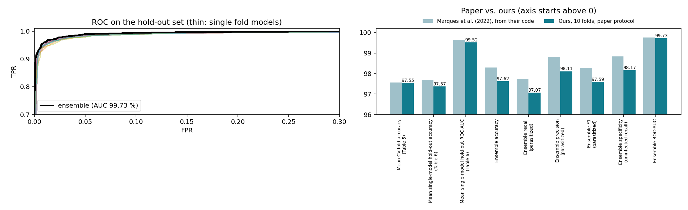
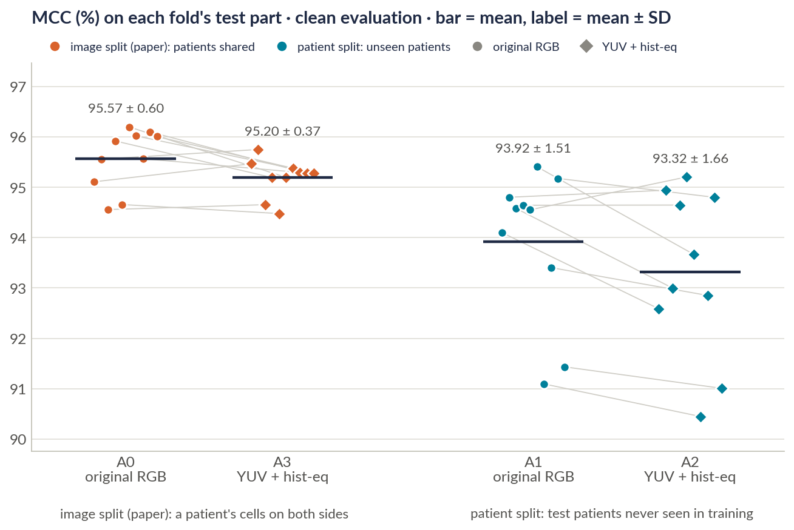

# Automated Malaria Cell Detection


-FF6F00)


Deep-learning classification of single red-blood-cell images as **parasitized** or **uninfected**, built on the
NIH Malaria Cell Images dataset. Phase 2 of our project reproduces the base paper,
**Marques et al. (2022), *An ensemble-based approach for automated medical diagnosis of malaria using EfficientNet***
(Multimedia Tools and Applications 81, 28061–28078), from the authors' own code. Phase 3 tests two pre-registered
hypotheses: does its ~98 % accuracy survive patients the model has never seen (H1), and does YUV stain normalisation
help on them (H2)?

**Answer:**
- The accuracy largely survives: the ensemble scores **98.45 %** on 40 unseen patients. Measured on identical cells, patient leakage is real but small: 0.85 pp of MCC (95 % CI 0.05–2.02).
- YUV normalisation (luma histogram equalisation) does not help: its effect lies within ±1 pp of MCC.
- Combined per patient, the cell calls identify 26 of 28 infected and all 12 healthy unseen patients (exploratory, on curated crops).

Full write-up: [IEEE-format paper (PDF)](docs/ieee/main.pdf) · [report](docs/report.md) · [final deck (PDF)](slides/Malaria_Phase3_Final.pdf) · [team handover](docs/TEAM_HANDOVER.md).

<p align="center">
  
</p>

## Highlights

- **Faithful reproduction.** The recipe follows the authors' own executed notebook (Springer supplementary file
  [MOESM1](https://static-content.springer.com/esm/art%3A10.1007%2Fs11042-022-12624-6/MediaObjects/11042_2022_12624_MOESM1_ESM.pdf)),
  not only the paper text. That code differs from the text in eight places, from the pretrained weights to the
  hold-out size. [32 tests](tests/test_marques2022_exact.py) check our implementation against the paper, including
  the exact parameter count of its Table 2 (4,223,934).
- **All 10 folds, in parallel.** One RunPod RTX 4090 per fold, about **11 minutes per fold** against 4 h 46 min
  in the paper. The speed-ups (decoded-image cache, seeded multi-process augmentation, XLA) leave the maths unchanged.
- **Within 1 percentage point of the paper** on every headline metric (table below).
- **Two errors found in the paper**: its text swaps the ensemble's precision and recall, and its code evaluates
  on randomly augmented images. Both are documented and handled ([details](docs/report.md#3-paper-exact-10-fold-reproduction)).
- **Trained weights published**: the 10 fold models are on the
  [release page](https://github.com/amathziah/malaria-detection/releases/tag/v1.0-a0-10fold); nothing has to be retrained.
- **Phase 3: the paper's ~98 % survives unseen patients.**
  - On 40 held-out patients the ensemble reaches **98.45 %** (95 % CI 97.94–98.91).
  - Patient leakage is real but small: on identical cells, models that had seen the patient gain 0.85 pp of MCC
    (95 % CI 0.05–2.02) across 160 patients, and nothing on the 40 held-out patients.
  - YUV normalisation does not help (H2 rejected): its effect lies within ±1 pp of MCC.
- **Phase 3b, exploratory, on the saved predictions** ([addendum](docs/phase3b_addendum.md), fixed before running;
  [results](results/phase3b/phase3b_summary.md)): equivalence bounds, leakage on identical cells, a patient-level rule
  (26/28 infected and 12/12 healthy held-out patients) and an error audit.
- **Pre-registered, patient-level statistics.** The hypotheses, primary metric, tests and decision rules were committed
  ([plan](docs/phase3_analysis_plan.md)) before any of the 30 new models was trained. Every interval resamples whole
  patients, and the patient key is checked against NIH's own patient mapping.
- **30 models in an hour for $6.95**: one RunPod pod per fold trains A1, A2 and A3 in turn, driven in parallel by
  [`src/runpod_10fold.py run`](src/runpod_10fold.py).

## Results

Paper-exact reproduction, all 10 folds (`results/A0_10fold_paper/`). The paper's values are those its own
code printed (Supplementary MOESM1); ensemble metrics are on the 5,512-image hold-out set.

| Metric | Marques et al. (2022) | Ours | Δ (pp) |
|---|---:|---:|---:|
| Mean accuracy of the fold models on their CV test part (Table 5) | 97.56 % | **97.55 ± 0.30 %** | −0.01 |
| Mean accuracy of the fold models on the hold-out set (Table 6) | 97.69 % | 97.37 % | −0.32 |
| **Ensemble accuracy** (10 models, softmax averaging) | **98.29 %** | **97.62 %** | −0.67 |
| Ensemble recall, parasitized (sensitivity) | 97.74 % | 97.07 % | −0.67 |
| Ensemble precision, parasitized | 98.82 % | 98.11 % | −0.71 |
| Ensemble F1, parasitized | 98.28 % | 97.59 % | −0.69 |
| Ensemble ROC-AUC | 99.76 % | 99.73 % | −0.03 |
| Ensemble MCC | — | 0.95 | — |

Evaluated on clean (un-augmented) images, the same ensemble scores 97.64 %. A first, lighter reproduction
that followed the paper's text (3 of 10 folds, Kaggle 2× T4) reached 97.38 ± 0.74 % per fold and 97.57 % as an ensemble
([`results/A0_baseline/`](results/A0_baseline)).

### Phase 3: hypothesis tests

Clean evaluation, %, MCC × 100; ensemble values with 95 % patient-bootstrap intervals
([`results/ablation/`](results/ablation/ablation_summary.md); the paper's augmented protocol gives the same verdicts).

| ID | Split | Preprocessing | Hold-out | Fold MCC (mean ± SD) | Ensemble accuracy | Ensemble MCC |
|---|---|---|---|---|---|---|
| A0 | image (paper) | none | 5,512 cells / 200 patients | 95.57 ± 0.60 | 97.64 [97.02, 98.17] | 95.29 [94.03, 96.32] |
| A1 | patient | none | 5,550 cells / 40 unseen patients | 93.92 ± 1.51 | **98.45** [97.94, 98.91] | 96.90 [95.70, 97.79] |
| A2 | patient | YUV + hist-eq | 5,550 cells / 40 unseen patients | 93.32 ± 1.66 | 98.32 [97.71, 98.86] | 96.65 [95.23, 97.68] |
| A3 | image (paper) | YUV + hist-eq | 5,512 cells / 200 patients | 95.20 ± 0.37 | 97.64 [97.02, 98.17] | 95.29 [94.04, 96.32] |

- **H1 (leakage): not supported** by the pre-registered test.
  - On unseen patients the ensemble is not worse (MCC +1.62 pp, 95 % CI +0.01 to +3.12, Holm p = 0.15).
  - Cross-validation over 160 patients points the predicted way, at a small size: fold MCC −1.65 pp (95 % CI −3.28 to −0.02, Holm p = 0.14), 2.5× the spread. (Our plan's uncorrected Welch test gave Holm p = 0.023; it treated the folds as independent.)
  - The 40-patient hold-out draw happens to be about 1 pp easier than the average fold, and comparing different hold-out sets could only detect about 2.2 pp of MCC.
  - On identical cells (Phase 3b): −0.85 pp MCC (95 % CI −2.02 to −0.05) across 17,591 cells of 160 patients (single models), and 0.00 (−0.90 to +0.98) on 1,095 cells of the 40 held-out patients (ensembles). Leakage is real but small.
- **H2 (YUV on unseen patients): rejected.** Fold MCC −0.60 pp, smaller than the 1.51 pp fold SD; ensemble MCC −0.26 pp (95 % CI −0.85 to +0.23). Equivalence test (Phase 3b): the ensemble effect lies within ±1 pp (90 % CI −0.73 to +0.16). The step equalises brightness only, not stain colour.
- **Control:** YUV under the paper's split shows no detectable change (ensemble MCC +0.00 pp, 95 % CI −0.52 to +0.53; equivalent within ±1 pp).

**Phase 3b (exploratory, [results](results/phase3b/phase3b_summary.md)):**
- *Patient level:* a rule chosen on the 160 CV patients (at least 3 cells with P ≥ 0.80) calls 26 of 28 infected (92.9 %, exact 95 % CI 76.5–99.1) and 12 of 12 healthy held-out patients correctly. The two misses are the only patients with just 3 parasitized crops. NIH curated the crops, so this is not diagnostic accuracy on a smear.
- *Errors:* they cluster by patient (p < 0.001), and false alarms concentrate in infected patients' smears (1.57 % vs 0.12 % of uninfected cells), consistent with parasites missed in the labels or with ambiguous cells (we can't tell which without an expert). Removing the 8 candidate label errors changes no verdict. A [blinded gallery](results/phase3b/phase3b_error_gallery.png) ([full-size pages](results/phase3b/phase3b_triage_pages.pdf)) is ready for the team's triage ([how](docs/TEAM_HANDOVER.md#6-team-task-blind-triage-of-our-errors)).

<p align="center">
  
</p>

## Experiments

| ID | Split | Preprocessing | Question | Status |
|---|---|---|---|---|
| A0 | image-level (paper) | none | Baseline reproduction, paper's text, 3 folds | **done** |
| **A0 · 10-fold** | image-level (paper) | none | Baseline reproduction, paper's code, all 10 folds | **done** |
| A1 | patient-grouped | none | **H1**: does accuracy drop once patient-level leakage is removed? | **done**: not supported (small CV effect) |
| A2 | patient-grouped | YUV + histogram equalisation | **H2**: does stain normalisation help on unseen patients? (vs. A1) | **done**: rejected |
| A3 | image-level | YUV + histogram equalisation | Control: does YUV change anything when patients are shared? (vs. A0) | **done**: no change |

## Method at a glance

| Component | Setting (from the paper's code) |
|---|---|
| Data | NIH Malaria Cell Images: 27,558 cells, 13,779 per class, 200 patients (checked against NIH's patient mapping) |
| Split | 80 % for stratified 10-fold cross-validation (22,046), 20 % untouched hold-out set (5,512); A1/A2: the same proportions by patient (40 held-out patients, `StratifiedGroupKFold`) |
| Model | EfficientNet-B0, noisy-student weights (qubvel `efficientnet` 1.1.1), all layers trainable |
| Head | Global average pooling → Dense 128 → Dense 64 → Dense 32 (ReLU, dropout 0.3 each) → Dense 2 (softmax) |
| Input | cv2 nearest-neighbour resize to 224 × 224, pixels / 255 |
| Augmentation | albumentations 0.5.2: rotate/flip/transpose, noise, blur, shift-scale-rotate, optical/grid/piecewise-affine distortion, CLAHE/sharpen/emboss/contrast/brightness |
| Training | Adam 1e-4, categorical cross-entropy with label smoothing 0.1, batch 16, 33 epochs × 1,240 steps, ReduceLROnPlateau (×0.5, patience 6, min 1e-6), best-val_loss checkpoint |
| Ensemble | Mean of the 10 fold models' softmax outputs |

## Repository structure

```
malaria-detection/
├── notebooks/
│   ├── Phase2_A0_10fold_PaperExact.ipynb             paper-exact 10-fold reproduction (train any folds, build all tables)
│   ├── Phase2_A0_10fold_PaperExact_executed.ipynb    the same, executed: all tables and figures
│   ├── Phase3_Ablation_A1_A3.ipynb                   A1–A3: patient split, YUV, hypothesis tests
│   ├── Phase3_Ablation_A1_A3_executed.ipynb          the same, executed on the real results
│   ├── Phase2_Baseline_Reproduction_Marques2022.ipynb            first reproduction (A0, 3 folds)
│   ├── Phase2_Baseline_Reproduction_Marques2022_executed.ipynb   its Kaggle run, with outputs
│   └── Phase2_A0_Results.ipynb                       A0 results viewer
├── src/
│   ├── marques2022_exact.py          the paper's recipe + the A1–A3 switches (patient split, YUV)
│   ├── make_ablation_splits.py       builds and checks the patient split (NIH patient mapping)
│   ├── ablation_stats.py             H1/H2 tests: patient bootstrap, corrected t-test, Holm
│   ├── ablation_figures.py           the ablation figures (notebook, report, slides)
│   ├── phase3b_analysis.py           Phase 3b: equivalence, same-cell leakage, patient level, error audit
│   ├── triage_kit.py                 full-size, numbers-only pages of the error gallery for the blind triage
│   ├── runpod_10fold.py              one RunPod GPU per fold, driven in parallel; collects the results
│   ├── runpod_requirements.txt       pinned training environment
│   ├── phase2_baseline_marques2022.py first reproduction as a plain script
│   ├── check_results.py              one experiment vs. the paper
│   ├── compare_experiments.py        A0–A3 side by side (H1/H2)
│   └── fill_slide_table.py           writes A0 numbers into the archived deck
├── tests/                           129 tests: fidelity to the paper, splits/YUV, statistics, Phase 3b, triage kit, figures, launcher
├── results/
│   ├── A0_10fold_paper/              10-fold reproduction: tables, figures, per-fold outputs, pod logs
│   ├── A0_baseline/                  first reproduction (3 folds)
│   ├── A1_slide_split/ A2_yuv_slide/ A3_yuv_image/   hypothesis experiments: splits, folds, tables, figures
│   ├── ablation/                     hypothesis tests over A0–A3 (+ paper_protocol/)
│   ├── phase3b/                      exploratory analyses on the saved predictions, error gallery
│   └── ablation_runpod/              pod bookkeeping and logs of the A1–A3 run
├── docs/
│   ├── PROJECT_GUIDE.md / .pdf       visual walkthrough of the whole project (+ figures/)
│   ├── ieee/                         the IEEE-format paper: main.pdf (LaTeX source, tables generated from results/)
│   ├── phase3_analysis_plan.md       hypotheses, tests and decision rules, fixed before the A1–A3 runs
│   ├── phase3b_addendum.md           the Phase 3b analyses and one correction, fixed before running them
│   ├── TEAM_HANDOVER.md              for the team: findings, numbers to know, likely questions, the blind triage
│   └── report.md                     project report
├── reports/                          literature review behind Phase 3b (its sources: research_notes/)
├── slides/                           Phase 3 final deck (pptx + PDF); Phase 2 long and short decks (+ archive/)
├── kaggle_run/                       Kaggle kernel configuration used for A0
└── requirements.txt                  dependencies of the helper scripts
```

## Getting started

### Use the trained models (no training needed)

```bash
gh release download v1.0-a0-10fold -R amathziah/malaria-detection -D models/A0_10fold_paper
cd models/A0_10fold_paper && shasum -a 256 -c SHA256SUMS.txt && cd -     # optional integrity check
```

```python
import sys; sys.path.insert(0, "src")
import numpy as np
import marques2022_exact as mx                     # needs the environment in src/runpod_requirements.txt

x = np.stack([mx.load_resized("cell.png")])        # uint8, 224 × 224 × 3, read exactly as in training
model = mx.build_model(weights=None)
probs = []
for k in range(10):                                # the paper's ensemble: average the 10 fold models
    model.load_weights(f"models/A0_10fold_paper/fold_{k}_best.h5")
    probs.append(model.predict(x, verbose=0))
p = mx.ensemble_probs(probs)                       # columns: [Parasitized, Uninfected]
print(mx.TIPOS[p[0].argmax()], f"P(parasitized) = {p[0, 0]:.3f}")
```

### Inspect the results (no GPU needed)

```bash
pip install -r requirements.txt
python src/check_results.py results/A0_10fold_paper     # 10-fold reproduction vs. the paper
python src/check_results.py                             # first reproduction (A0)
```

### Reproduce the 10-fold run

The environment is pinned in [`src/runpod_requirements.txt`](src/runpod_requirements.txt) (TensorFlow 2.15, the last
Keras 2 release, `efficientnet` 1.1.1, `albumentations` 0.5.2 + `imgaug` 0.4.0, `numpy` 1.23.5).

- **One GPU machine:** open `notebooks/Phase2_A0_10fold_PaperExact.ipynb`, set `FOLDS_TO_TRAIN = list(range(10))`
  and run all cells. The NIH dataset (353 MB) is downloaded automatically.
- **RunPod, one GPU per fold** (API key in `$RUNPOD_API_KEY` or `~/.runpod_key`, SSH key registered on RunPod):

  ```bash
  python src/runpod_10fold.py up --folds 0-9      # create pods, install, start training
  python src/runpod_10fold.py watch               # copy each finished fold home, terminate its pod
  ```

  Then run the notebook with `FOLDS_TO_TRAIN = []` to build the paper's tables, the ensemble and the figures.

### Reproduce the hypothesis experiments (A1–A3)

```bash
python src/make_ablation_splits.py                           # rebuild + check the patient split (already committed)
python src/runpod_10fold.py --experiments A1,A2,A3 run --folds 0-9   # one pod per fold trains A1, A2, A3 in turn
python src/ablation_stats.py                                 # the hypothesis tests (results/ablation/)
python src/phase3b_analysis.py                               # Phase 3b exploratory analyses (results/phase3b/)
python src/triage_kit.py                                     # full-size pages of the triage gallery
```

Then run `notebooks/Phase3_Ablation_A1_A3.ipynb` with `FOLDS_TO_TRAIN = []` for every table and figure.
On one GPU machine, set `FOLDS_TO_TRAIN = list(range(10))` in that notebook instead.

> RunPod switches off its v1 REST API, which `src/runpod_10fold.py` uses, on 15 Nov 2026. Later runs need the v2 API
> ([migration guide](https://docs.runpod.io/api-reference-v2/migrate-from-v1)).

### Run the tests

```bash
python -m pytest tests/ -q        # in the pinned environment; ~15 s on a laptop CPU
```

## Documentation

- **[Project guide](docs/PROJECT_GUIDE.md)** ([PDF](docs/PROJECT_GUIDE.pdf)): a visual, plain-language walkthrough of the
  dataset, the model and its 4.2 M parameters, the training recipe, the code function by function, how we evaluate
  (folds, ensemble, precision, recall, F1/F2, ROC-AUC, MCC, pp, what a good value is), the results and the hypotheses,
  with a glossary and a one-page presentation cheat sheet.
- **[IEEE-format paper](docs/ieee/main.pdf)**: the whole project as a conference paper, 8 pages ([LaTeX source](docs/ieee/);
  tables generated from `results/` by `docs/ieee/make_tables.py`).
- [Project report](docs/report.md): method, results, deviations from the paper, findings.
- [Phase 3 analysis plan](docs/phase3_analysis_plan.md): what we tested and how we would decide, fixed before the runs.
- [Phase 3b addendum](docs/phase3b_addendum.md): one correction and four exploratory analyses, fixed before running them.
- [Literature review](reports/Strengthening%20malaria%20ablation%20results.md): the evidence behind the Phase 3b analyses.
- [Team handover](docs/TEAM_HANDOVER.md): the findings, the numbers to know, likely questions, and the blind-triage task.
- [Results guide](results/README.md): every output file explained.
- [Slides](slides/): the Phase 3 final deck ([PDF](slides/Malaria_Phase3_Final.pdf)), plus the Phase 2 31-slide deck and 13-slide short version, all with speaker notes.

## Team

Rishihood University. Course project, Phases 1–3.

| Member | Role |
|---|---|
| J Amathziah ([@amathziah](https://github.com/amathziah)) | Experiments on Kaggle, repository |
| C Murali Madhav ([@HackHeroic](https://github.com/HackHeroic)) | Code: notebooks, reproduction pipeline, GPU runs |
| Ravi Yadav ([@RAVIYADAV6522](https://github.com/RAVIYADAV6522)) | Slides |
| Pugazhendhi J ([@pugazhjs9](https://github.com/pugazhjs9)) | Report |

## References

- G. Marques, A. Ferreras, I. de la Torre-Díez, "An ensemble-based approach for automated medical diagnosis of malaria
  using EfficientNet," *Multimedia Tools and Applications*, 81, 28061–28078, 2022. doi:10.1007/s11042-022-12624-6 ·
  [PDF](https://drive.google.com/file/d/1kMiYQorrZFmbL632-3BGuVndGzLHqF6o/view?usp=sharing)
- S. Rajaraman et al., "Pre-trained convolutional neural networks as feature extractors toward improved malaria parasite
  detection in thin blood smear images," *PeerJ*, 6:e4568, 2018 (the NIH Malaria Cell Images dataset) ·
  [PDF](https://drive.google.com/file/d/1DLsZUgCazbFQD3RCq2p3JH9yNGUq7_Yr/view?usp=sharing)
- M. Tan, Q. V. Le, "EfficientNet: Rethinking model scaling for convolutional neural networks," *ICML*, 2019.
