# Malaria Cell Detection: Final Study Guide

*Everything needed to explain the whole project at the final submission, in the order of the course brief. Read it
once with the deck open (about 90 minutes). Before the defence, go over the numbers card (section 11) and the
question drill (section 12).*

| | |
|---|---|
| **Team** | J Amathziah (230139) · C Murali Madhav (230115) · Ravi Yadav (230131) · Pugazhendhi J (230066) |
| **Topic** | Malaria cell detection on the NIH Malaria dataset (one of the brief's eight topics) |
| **Base paper** | G. Marques, A. Ferreras, I. de la Torre-Díez, *An ensemble-based approach for automated medical diagnosis of malaria using EfficientNet*, Multimedia Tools and Applications 81 (2022) |
| **Our change** | YUV histogram-equalisation stain normalisation (H2), tested on patients the model has never seen (H1: a patient-level split) |
| **Deliverables** | IEEE paper *98 % Accuracy Holds on Unseen Patients* (`Malaria_IEEE_Paper.pdf`, in the repository's top folder, 8 pages) · deck `slides/Malaria_Phase3_Final.pptx` (17 slides in five parts, plus references) · code, results and all 40 trained models on GitHub |
| **Deck in five parts** | Opening: slides 1 to 3 (title, what we achieved, roadmap) · **Part 1** The problem: 4 to 6 · **Part 2** Reproduction: 7 to 9 · **Part 3** Our change: 10 · **Part 4** Results: 11 to 14 · **Part 5** Failure analysis and conclusion: 15 to 17 · references: 18. A tracker at the top right of every slide names the part |

**Contents**

0. [The brief, and where we answered each part](#the-brief-and-where-we-answered-each-part)
1. [The whole project in two minutes](#the-whole-project-in-two-minutes)
2. [Step 1 · Literature survey](#step-1-literature-survey)
3. [Step 2 · Base paper and reproducibility checklist](#step-2-base-paper-and-reproducibility-checklist)
4. [Step 3 · Reproducing the paper](#step-3-reproducing-the-paper)
5. [Step 4 · Hypotheses and predictions, fixed before coding](#step-4-hypotheses-and-predictions-fixed-before-coding)
6. [Step 5 · The experiment: design, statistics, results](#step-5-the-experiment-design-statistics-results)
7. [What our predictions taught us](#what-our-predictions-taught-us)
8. [Step 6 · Failure analysis](#step-6-failure-analysis)
9. [Limitations, and how to talk about them](#limitations-and-how-to-talk-about-them)
10. [The paper and the code, section by section](#the-paper-and-the-code-section-by-section)
11. [Numbers card](#numbers-card)
12. [Question drill: 32 likely questions](#question-drill-32-likely-questions)
13. [Glossary of the Phase 3 terms](#glossary-of-the-phase-3-terms)

Deeper background on the dataset, EfficientNet-B0, the training recipe and every Phase 2 metric is in the
[Project Guide](PROJECT_GUIDE.pdf). This guide summarises it where needed.

## The brief, and where we answered each part

The brief asks us to pick a healthcare vision topic, reproduce a paper, then propose and test **one change of our
own**, and write it up like a conference paper. Marks come from **predictions, experiments and defence**.

| Step (milestone) | The brief asks | What we did | Where to point |
|---|---|---|---|
| 1 · Literature survey (M1) | Read 10 to 20 recent papers; note methods, datasets, metrics | 11 malaria studies (2016 to 2024), plus 7 methods papers. Found three gaps | Slide 5 (Part 1) · paper §II |
| 2 · Pick a base paper (M1) | One paper with public code and data; fill the reproducibility checklist | Marques et al. 2022: executed notebook public, NIH data public | Slide 7 (Part 2) · `docs/REPRODUCIBILITY_CHECKLIST.md` |
| 3 · Reproduce (M2) | Re-run on the same data and land near the reported metric | Code-exact, all 10 folds: ensemble 97.62 % vs 98.29 %; fold models 97.55 % vs 97.56 % | Slides 8 and 9 (Part 2) · paper §IV-A, §V-A |
| 4 · Hypothesis + Introduction (M3) | One change, its predicted effect and why, submitted before coding | H1 and H2 in the Phase 2 deck; analysis plan committed on 2 Nov at 03:24, before any A1 to A3 model was trained | Slide 10 (Part 3) · paper §I · `docs/phase3_analysis_plan.md` |
| 5 · Implement and test (M4) | Make the change, run ablations, measure what moved | A 2 × 2 ablation (A0 to A3), 30 new models | Slides 10 to 13 (Parts 3 and 4) · paper §IV-B, §V-B, §V-C |
| 6 · Analyse and write (M5) | Failure analysis and metrics; IEEE paper; defend it | Errors by patient, false alarms, label-error candidates, blind triage; recall-first threshold; patient-level rule; 8-page IEEE paper | Slides 14 to 17 (Parts 4 and 5) · paper §V-D to §VII |
| Rule 1 | Predict before you experiment; being wrong is fine | Both predictions were fixed before training, and each one taught us something we can explain | Slide 14 · [section 7](#what-our-predictions-taught-us) |
| Rule 2 | No clinical claims; report recall and AUC; include limitations | Recall, specificity, MCC and ROC-AUC for every experiment; a limitations slide and section | Slides 11, 16 and 17 · paper Tables III to V, §VII |

> **The "one change" question.** Each experiment changes exactly one thing. Our change to the method is **H2, YUV
> stain normalisation**. H1 does not change the model: it changes how we *test* it (split by patient), so that H2 is
> measured on patients the model has never seen. A3 is the control.

## The whole project in two minutes

1. **The problem.** Malaria is diagnosed by a technician counting Giemsa-stained blood cells under a microscope. This
   is slow, needs scarce experts, and varies between observers. CNNs report 96 to 99.9 % accuracy on the public NIH cell
   images.
2. **The catch.** Most studies split the *images* at random, so cells of the same patient sit in both the training
   and the test set (**patient leakage**). Only Rajaraman et al. test on unseen patients.
3. **Reproduction.** We rebuilt the EfficientNet-B0 ten-fold ensemble of Marques et al. (2022) from the authors' own
   executed notebook.
   - Ensemble accuracy: 97.62 % against their 98.29 %, with every metric within 1 pp.
   - Their text swaps precision and recall, and their code scored augmented test images.
   - Our training runs about 25× faster.
4. **Hypotheses, fixed in advance.**
   - H1: a patient split lowers the scores.
   - H2: YUV stain normalisation helps on unseen patients.
5. **Results.**
   - **H1: accuracy holds on unseen patients.** The ensemble scores **98.45 %** on 40 unseen patients, on par with
     the paper. Measured on identical cells, leakage is small: **0.85 pp of MCC**.
   - **H2: the model is already stain-robust.** YUV changes MCC by **−0.26 pp**, within ±1 pp of zero, so the simpler
     pipeline is enough.
6. **Failure analysis.**
   - Errors cluster in a few patients.
   - Almost all false alarms fall on infected patients' smears, which fits possible label noise.
   - A per-patient rule finds 26 of 28 infected and 12 of 12 healthy unseen patients. This is exploratory and uses
     curated cells.

> **Say it in one breath.** "We rebuilt a published 98 % malaria classifier from its authors' own code, within one
> point and 25 times faster. Before training anything new we predicted that its accuracy would fall on patients it had
> never seen, and that stain normalisation would help there. The data gave a stronger answer: the accuracy holds on
> unseen patients (98.45 %), leakage is small (under one point of MCC), and the model is already stain-robust, so
> normalisation is unnecessary. Every test was fixed before we ran it."

## Step 1 · Literature survey

We reviewed **11 studies** on the NIH cell images, from Liang et al. (2016) to Mujahid et al. (2024), plus the methods
papers we rely on:

- EfficientNet and noisy-student training, for the model;
- Nadeau-Bengio, Holm and Lakens, for the statistics;
- Northcutt, for label errors;
- Tellez, for stain augmentation.

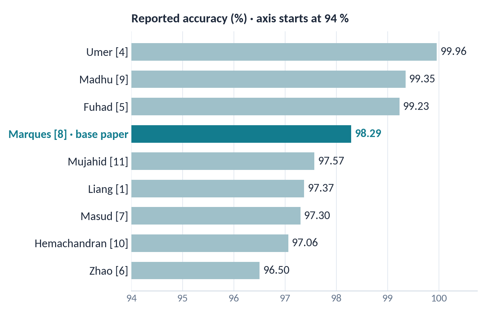

| Study | Approach | Reported result |
|---|---|---|
| Liang et al. 2016 | 16-layer CNN from scratch (transferred AlexNet features: 91.99 %) | 97.37 % |
| Rajaraman et al. 2018 | Released the dataset. Pre-trained CNNs as feature extractors; also evaluated per patient | 98.6 % per cell, 95.9 % per patient |
| Rajaraman et al. 2019 | Ensemble of VGG-19 and SqueezeNet; patient-level evaluation | (ensemble study) |
| Umer et al. 2020 | YUV conversion and luma histogram equalisation before a stacked CNN | ≈ 99.9 % |
| Fuhad et al. 2020 | Light CNN on a phone, after setting aside 5.1 % of the cells as mislabelled or suspicious | 99.23 % |
| Zhao et al. 2020 | Extends detection to a second species | 96.5 % |
| Masud et al. 2020 | 409 K-parameter CNN in a mobile app | 97.3 % |
| **Marques et al. 2022 (base)** | **EfficientNet-B0, ten-fold ensemble** | **98.29 %, ROC-AUC 99.76 %** |
| Madhu et al. 2023 | Inception-based capsule network | 99.35 % |
| Hemachandran et al. 2023 | Comparison of backbones | 97.06 % |
| Mujahid et al. 2024 | Comparison of backbones | 97.57 % |

**The three gaps we found.**

1. **Patient leakage.** Most studies split images at random. Only Rajaraman et al. (2018, 2019) evaluate on unseen
   patients, and their scores drop there.
2. **The numbers are not comparable.** The studies use 5-fold, 10-fold or 80:20 protocols, on original or cleaned
   labels.
3. **The work is rarely reproducible.** Few studies publish their full training code. Marques et al. published their
   executed notebook.

> **Say it like this.** "Eleven studies report 96.5 to 99.9 per cent, but they can't be compared directly, and only
> Rajaraman's group tests on patients the model hasn't seen. That gap is our project."

## Step 2 · Base paper and reproducibility checklist

**Why Marques et al. (2022)?**

- It is a strong result: 98.29 % accuracy and ROC-AUC 99.76 %.
- It uses a standard architecture.
- Its authors published their executed notebook as a supplementary file, so we could rebuild the recipe exactly.
- The data are public.

**The reproducibility checklist** (full version in `docs/REPRODUCIBILITY_CHECKLIST.md`, slide 7):

| Item | In the paper? | What we found, and what we did |
|---|---|---|
| Dataset public | ✓ NIH Malaria, 27,558 cells | Downloaded automatically; patient IDs read from the file names and checked against NIH's own mapping |
| Code public | ✓ executed notebook | We follow the code, not the text, wherever they differ |
| Library versions | Partly, in the notebook | TensorFlow 2.3 then; we use 2.15, the last Keras 2 release, with the same `efficientnet` 1.1.1 and `albumentations` 0.5.2 |
| Pre-trained weights | Text: ImageNet | Code: noisy-student. We follow the code |
| Hyperparameters | The text differs from the code in 8 places | Counted on slide 7; we follow the code |
| Data split | 80/20 then 10 folds, **unseeded** | Cannot be recovered. We sort and seed the split and store its fingerprint with every fold |
| Evaluation protocol | Not stated | The code scored **randomly augmented** test images. We report both protocols |
| Metrics | Accuracy, precision, recall, F1, AUC | The text **swaps precision and recall**; Table 6's "accuracy" is (precision + recall) / 2 |
| Model size | Table 2: 4,223,934 parameters | Matched exactly, and a test checks it |
| Hardware and time | GTX 1050, 4 h 46 min per fold | RTX 4090, about 11 min per fold |
| Patient-level evaluation | ✗ random image split | This became our H1 |
| Trained models released | ✗ | We release all 40 of ours (`v1.0-a0-10fold`, `v2.0-ablation`) |

**The code differs from the text** (slide 7 counts these):

| Setting | Paper's text / our first guess | Authors' code (what we follow) |
|---|---|---|
| Weights | ImageNet | noisy-student, qubvel `efficientnet` 1.1.1 |
| Head | GAP → dropout → 1 sigmoid | GAP → 128 → 64 → 32 (dropout 0.3) → 2 softmax |
| Loss | binary cross-entropy | categorical cross-entropy, label smoothing 0.1 |
| Schedule | ≤ 15 epochs, early stopping | 33 epochs, LR halved on plateau, best checkpoint |
| Batch size | 128 | 16 (1,240 steps per epoch) |
| Hold-out | 10 % | 20 % = 5,512 images, never trained on |
| Augmentation | flips, 90° rotations | heavy `albumentations`: noise, blur, distortions, CLAHE… |
| Evaluation | clean images | augmented images (one generator for all) |

## Step 3 · Reproducing the paper

### The data

- 27,558 single-cell crops: 13,779 parasitized and 13,779 uninfected.
- 200 patients (150 infected with *P. falciparum*, 50 healthy), photographed with a smartphone on a microscope at
  Chittagong Medical College Hospital, Bangladesh.
- **The patient is in the file name.** `C33P1thinF_IMG_..._cell_179.png` belongs to patient C33. All 27,558 cells map
  to NIH's patient list.
- **Both classes come from the same people.** 10,364 of the 13,779 uninfected cells (75 %) come from *infected*
  patients' smears, so almost every patient has cells in both classes.
- Patients differ widely: from 65 to 702 cells each.

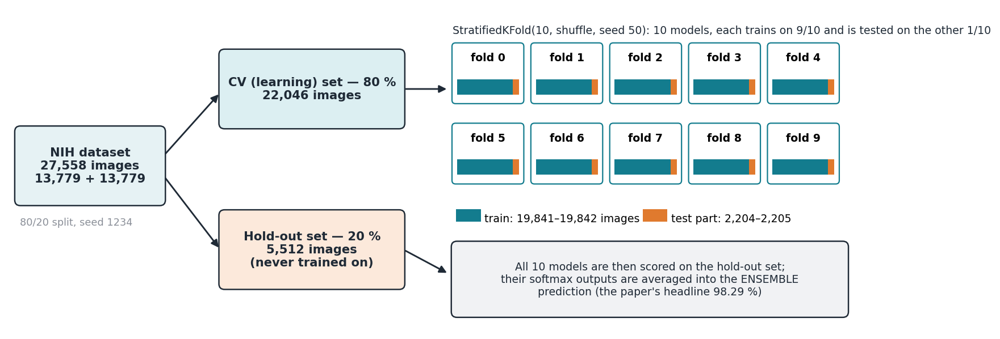

**The paper's split.**

- The data are split 80/20: 22,046 learning cells and 5,512 hold-out cells that no model ever trains on.
- The learning set is cut into 10 stratified folds. Each fold's model trains on 9 parts and is checked on the 10th.
- The 10 models are then averaged on the hold-out set.

### The model

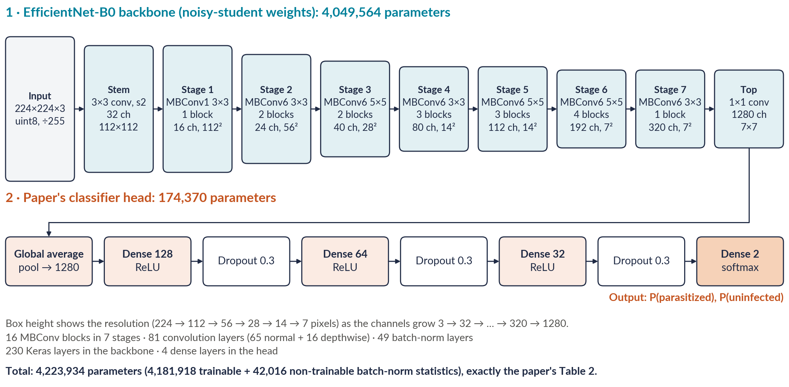

- **Backbone.** A stem convolution and 16 MBConv blocks in seven stages turn a 224 × 224 × 3 cell into
  7 × 7 × 1,280 feature maps.
- **MBConv block:** expand (1 × 1 convolution) → depthwise convolution → squeeze-and-excitation → project (1 × 1)
  → skip connection.
- **Head.** Global average pooling gives 1,280 numbers. Dense layers of 128, 64 and 32 units follow (ReLU,
  dropout 0.3), then a two-way softmax: P(parasitized) and P(uninfected).
- **Size.** 4,223,934 parameters, 4,181,918 of them trainable.

### The training recipe (from the authors' code)

- Categorical cross-entropy with **label smoothing 0.1**: targets of 0.95/0.05 instead of 1/0.
- Adam, learning rate 10⁻⁴. The rate is halved when the validation loss stalls for 6 epochs, down to 10⁻⁶.
- **33 epochs** of **batch 16** (1,240 steps per epoch); the best-validation-loss weights are restored at the end.
- Heavy random augmentation: flips, rotations, noise, blur, distortions, CLAHE, sharpening, embossing, and contrast
  and brightness changes.

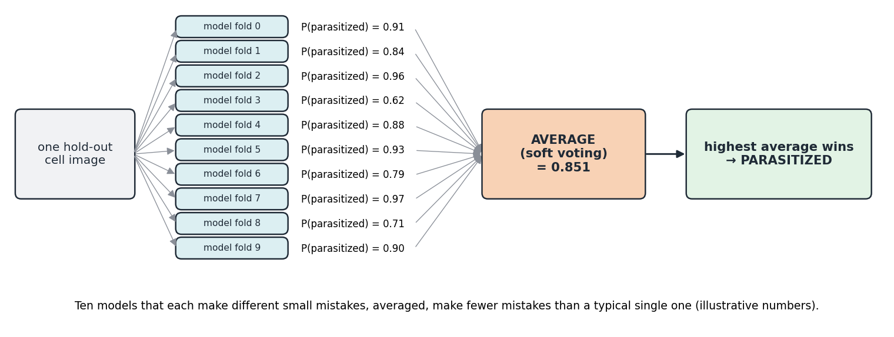

### Result: within 1 pp of the paper on every metric

| Metric (hold-out, 5,512 cells) | Paper | Ours (paper protocol) | Δ (pp) |
|---|---|---|---|
| Mean fold accuracy | 97.56 % | 97.55 % | −0.01 |
| **Ensemble accuracy** | **98.29 %** | **97.62 %** | **−0.67** |
| Recall (sensitivity) | 97.74 %\* | 97.07 % | −0.67 |
| Precision | 98.82 %\* | 98.11 % | −0.71 |
| Specificity | 98.84 % | 98.17 % | −0.67 |
| F1 | 98.28 % | 97.59 % | −0.69 |
| ROC-AUC | 99.76 % | 99.73 % | −0.03 |

\*Corrected values. The paper's text swaps precision and recall.

Our ensemble missed 80 of 2,730 infected cells and flagged 51 of 2,782 healthy ones (the paper: 62 and 32).

**Why the ensemble is 0.67 pp short.**

- The paper's random split had no seed and cannot be recreated, and we use a newer TensorFlow.
- Our ensemble gains 0.25 pp over its average member, where the paper's gained 0.60 pp.
- The gap is about three standard errors on 5,512 cells. Single models match the paper to 0.01 pp.

**What reading the authors' code revealed:**

1. The paper's text swaps the ensemble's precision and recall. The true recall is 97.74 %, not 98.82 %.
2. Every reported prediction was made on a randomly augmented image. Scoring clean images changes our numbers by at
   most 0.23 pp, so this doesn't explain their result.
3. Table 6's "accuracy" column is (precision + recall) / 2 of each printed report.

**Faster, with the same maths:**

- every image is decoded once into a shared `uint8` cache;
- the augmentation runs in 11 parallel workers, each batch seeded by (fold, epoch, batch);
- batches go to the GPU as bytes and are scaled inside the model;
- the training step is XLA-compiled, which takes it from 21 to 12.5 ms;
- 10 cloud GPUs run the 10 folds in parallel.

The result is about **11 min per fold on an RTX 4090, against 4 h 46 min** on the paper's GTX 1050. Arithmetic stays
float32.

**How we know the rebuild is faithful.** **32 automated tests** check it against the paper's printed outputs:

- the parameter counts of Table 2;
- the split and fold sizes;
- the augmentation pipeline, verbatim;
- the image loading, pixel for pixel;
- the loss, optimiser and callbacks;
- the classification reports.

## Step 4 · Hypotheses and predictions, fixed before coding

| | H1 · validation | H2 · preprocessing (our change) |
|---|---|---|
| **Change** | Split by patient, not by image; model unchanged | RGB → YUV → equalise the brightness (Y) histogram → RGB (Umer et al. 2020), on the patient split |
| **We expected** | Accuracy and MCC fall below the image-split baseline; the fold-to-fold spread widens | Higher recall and MCC than A1 on unseen patients; little change on the random split |
| **Because** | A patient's cells share stain, lighting and blood, so a random split lets the model recognise the patient rather than the parasite | Equalising brightness removes slide-specific cues, so the network has to rely on the parasite |
| **Falsified if** | Patient and image splits score the same | The gain over A1 is smaller than A1's fold-to-fold SD |

**The formal decision rules** (`docs/phase3_analysis_plan.md`):

- **H1 is supported** if A1's ensemble MCC is lower than A0's, with the 95 % CI of the difference excluding 0
  (Holm p < 0.05).
- **H2 is rejected** if A2's mean fold-MCC gain over A1 is smaller than A1's fold-MCC SD.
- **The control** counts as "little change" if |A3 − A0| in mean fold MCC is below A0's fold-MCC SD.
- **Primary metric:** MCC. **Primary protocol:** clean (un-augmented) evaluation.

**The timeline is our proof that we predicted before experimenting:**

| When | What | Evidence |
|---|---|---|
| Phase 2 (October) | H1, H2 and their falsification rules presented | Phase 2 deck, slides 28 to 29 |
| 2 Nov, 03:24 | Analysis plan and notebook committed, **before any A1 to A3 model was trained** | commit `0c086ee`, `docs/phase3_analysis_plan.md` |
| 2 Nov, morning | 30 models trained on RunPod (about 1 hour) | `results/A1_*`, `A2_*`, `A3_*`; release `v2.0-ablation` |
| 2 Nov, 17:32 | Four exploratory analyses fixed in a dated addendum, **before running them** | commit `8e17fd6`, `docs/phase3b_addendum.md` |
| 2 Nov, evening | Phase 3b analyses run on the saved predictions | `results/phase3b/` |

**The paper's Introduction (§I)** follows the brief's M3:

- the clinical problem;
- two questions: can the published numbers be reproduced, and do they hold on unseen patients?
- five contributions:
  1. a code-exact reproduction;
  2. three corrections to the paper's reporting;
  3. a pre-registered one-variable ablation;
  4. a patient-level statistical analysis;
  5. exploratory analyses fixed in an addendum.

## Step 5 · The experiment: design, statistics, results

### The 2 × 2 design: each comparison changes one thing

| ID | Split | Preprocessing | Question it answers |
|---|---|---|---|
| A0 | image (the paper's) | none | the baseline (Phase 2) |
| A1 | patient | none | **H1:** A1 vs A0, does leakage inflate the score? |
| A2 | patient | YUV + hist.-eq. | **H2:** A2 vs A1, does normalisation help on unseen patients? |
| A3 | image (the paper's) | YUV + hist.-eq. | **Control:** A3 vs A0, does YUV matter when patients are shared? |

**Held fixed in every experiment:**

- the model and its weights;
- the loss and optimiser;
- 33 epochs and batch 16;
- the augmentation;
- the per-fold seeds;
- the 10-model ensemble.

A1 and A2 use the identical split, and A3 reuses A0's split cell for cell, so both of those comparisons are
**paired** (the same cells in both arms).

### Switch 1: the patient split (`src/marques2022_exact.py`)

```python
def patient_id(file):
    """The patient of an NIH cell image: the leading C-number of its file name ("C37BP2_thinF_..." -> "C37")."""
    m = re.match(r"^(C\d+)", os.path.basename(str(file)))
    return m.group(1)

def patient_split(df, seed=1234, outer_splits=5):
    y, groups = _binary_labels(df), df["file"].map(patient_id).values
    outer = StratifiedGroupKFold(outer_splits, shuffle=True, random_state=seed)
    candidates = list(outer.split(df, y, groups))
    # take the candidate closest to 20 % of the cells and 50 % parasitized (a rule on labels only)
    scores = [abs(len(hold) / len(df) - 0.2) + abs(y[hold].mean() - 0.5) for _, hold in candidates]
    learn_pos, hold_pos = candidates[int(np.argmin(scores))]
    return df.iloc[learn_pos], df.iloc[hold_pos]
```

**How it works.**

- `StratifiedGroupKFold` keeps every patient's cells together (*group*) while balancing the classes (*stratified*).
- The rule picks one of five candidate hold-out sets using labels only, never model scores.

**What it produces.**

- A hold-out set of **5,550 cells from 40 patients** (28 infected, 12 healthy), 50.7 % parasitized.
- The other **160 patients** form 10 folds of 15 to 17 patients each.
- The split is committed to the repository, and every training run checks its fingerprint (`ff94f8c3b200e708`).
- `check_no_shared_patients` raises an error if any patient appears on both sides.

### Switch 2: YUV stain normalisation

```python
def yuv_equalize(bgr):
    yuv = cv2.cvtColor(bgr, cv2.COLOR_BGR2YUV)
    yuv[..., 0] = cv2.equalizeHist(yuv[..., 0])     # equalise brightness (Y) only; colour (U, V) untouched
    return cv2.cvtColor(yuv, cv2.COLOR_YUV2BGR)
```

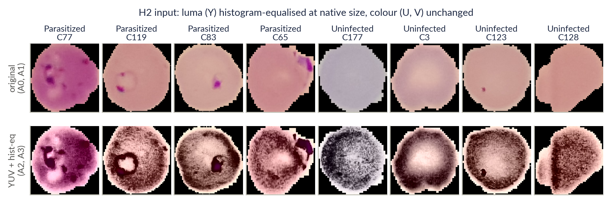

**How the step is applied.**

- It runs at each image's native size, *before* the unchanged resize and augmentation.
- The black background stays black.
- We left out Umer's 120 × 120 resize and their edge kernel, which the paper does not specify.

**Key point for the defence:** the step changes **brightness only**. It does not touch stain *colour*.

### How we decide: the statistics in plain words

**1. MCC, the primary metric.**

$$\text{MCC} = \frac{TP\cdot TN - FP\cdot FN}{\sqrt{(TP+FP)(TP+FN)(TN+FP)(TN+FN)}}$$

**Worked example: the A1 ensemble on 5,550 cells.**

- TP = 2,760 (parasites found), FN = 55 (missed), FP = 31 (false alarms), TN = 2,704.
- Accuracy = (2,760 + 2,704) / 5,550 = 98.45 %.
- Recall = 2,760 / 2,815 = 98.05 %.
- Specificity = 2,704 / 2,735 = 98.87 %.
- MCC = 0.9690, which we write as **96.90** (× 100).

**Why MCC?**

- It uses all four boxes of the confusion matrix and is high only when *both* classes are predicted well.
- Unlike accuracy, it is not flattered when one class dominates. The class mix varies between patient folds.

**2. The patient bootstrap, for honest confidence intervals.**

```python
def _patient_weights(groups, n_boot, rng):
    """Cell weights for each bootstrap resample: how often the cell's patient was drawn."""
    _, inv = np.unique(np.asarray(groups), return_inverse=True)
    n_groups = inv.max() + 1
    for _ in range(n_boot):
        yield np.bincount(rng.integers(0, n_groups, n_groups), minlength=n_groups)[inv].astype(float)
```

**What it does.** We draw 40 patients *with replacement*, 10,000 times. Each time we recompute the metric, and the
middle 95 % of those values is the 95 % CI.

**Why whole patients?** A patient's cells share stain, lighting and blood, so they are not independent. With cells
resampled one by one, the interval would be too narrow. Patient clustering inflates the variance **2.3×** for
accuracy and **2.6×** for MCC (the *design effect*).

**3. Paired versus unpaired comparisons.**

- **Paired:** A2 vs A1, and A3 vs A0, score the same cells. Both arms see the same resample, so noise cancels.
  This design can detect an effect of about **0.77 pp** of MCC.
- **Unpaired:** A1 vs A0 have different hold-out sets, so each arm resamples its own patients. This could detect only
  about **2.2 pp**. That is why we later measured leakage on identical cells.

**4. The Nadeau-Bengio corrected t-test, for fold scores.**

```python
def corrected_resampled_ttest(diffs, n_train, n_test):
    """Nadeau & Bengio (2003): t = mean(d) / sqrt((1/k + n_test/n_train) * var(d)), df = k - 1."""
    d = np.asarray(diffs, float)
    k, var = len(d), d.var(ddof=1)
    t = d.mean() / np.sqrt((1 / k + n_test / n_train) * var)
    return float(t), float(2 * sps.t.sf(abs(t), df=k - 1))
```

**Why it is needed.** Any two of the ten fold models share 8 of their 9 training parts, about 89 % of their data. So
their scores are correlated, and a plain t-test is far too confident. The extra term `n_test / n_train` (= 1/9)
widens the interval to account for that.

**Our correction.** Our plan used a plain Welch test for the unpaired H1 fold comparison; it gave Holm p = 0.023. We
corrected it to p = 0.14 and report both values.

**5. The Holm correction, for three contrasts at once.**

- Sort the three p-values. Multiply the smallest by 3, the next by 2 and the largest by 1, and never let a value fall
  below the one before it.
- **Example:** 0.01, 0.03 and 0.04 become 0.03, 0.06 and 0.06.
- **Why:** testing three things at once raises the chance of a false "significant".

**6. Equivalence (TOST) and the minimum detectable effect.**

- **"Not significant" does not mean "no effect".** It can also mean the test was too weak to see one.
- **TOST** asks something stronger: is the 90 % CI entirely inside a margin we call negligible, ±1 pp of MCC? If so,
  the effect is practically zero.
- **MDE (minimum detectable effect)** is the smallest true effect a design detects 80 % of the time.

```python
def tost_from_boot(boot, margin=0.01):
    lo, hi = np.percentile(boot, [5, 95])                  # 90 % interval of the bootstrapped difference
    return dict(lo90=lo, hi90=hi, equivalent=bool(-margin < lo and hi < margin))
```

### Results: every metric, all four experiments (clean evaluation)

| | A0 | A1 | A2 | A3 |
|---|---|---|---|---|
| Split / preprocessing | image / none | patient / none | patient / YUV | image / YUV |
| Hold-out set | 5,512 cells | 5,550 cells, 40 unseen patients | same as A1 | same as A0 |
| **Ensemble accuracy** | 97.64 % | **98.45 %** | 98.32 % | 97.64 % |
| **Recall (sensitivity)** | 97.18 % | 98.05 % | 98.22 % | 97.14 % |
| Specificity | 98.09 % | 98.87 % | 98.43 % | 98.13 % |
| **MCC × 100** | 95.29 | 96.90 | 96.65 | 95.29 |
| **ROC-AUC** | 99.68 % | 99.80 % | 99.76 % | 99.66 % |
| Mean fold MCC ± SD | 95.57 ± 0.60 | 93.92 ± 1.51 | 93.32 ± 1.66 | 95.20 ± 0.37 |
| Mean fold accuracy ± SD | 97.78 ± 0.30 | 97.24 ± 0.66 | 96.96 ± 0.75 | 97.60 ± 0.19 |
| Missed / false alarms | 77 / 53 | 55 / 31 | 50 / 43 | 78 / 52 |

A0 appears here under the clean protocol (97.64 %). Under the paper's augmented protocol it scores 97.62 %, the number
in section 4.

### H1: accuracy holds on unseen patients

We measured H1 three ways.

1. **The pre-registered test.** Ensembles on their own hold-out sets, which are different cells.
   - A1's MCC is *higher*: **+1.62 pp** (95 % CI +0.01 to +3.12, Holm p = 0.15).
   - Verdict: **no drop on the pre-registered test: the accuracy holds on unseen patients.**
2. **Cross-validation over 160 patients.**
   - Fold MCC: **−1.65 pp** (95 % CI −3.28 to −0.02, Holm p = 0.14).
   - Fold accuracy: 97.78 → 97.24 %.
   - The fold-to-fold spread widened **2.5×** (SD 0.60 → 1.51), as H1 predicted.
   - Validation also stops improving earlier: the median best epoch is 17 instead of 28.5.
   - A small trend in the predicted direction, not significant after the correction.
3. **Identical cells (Phase 3b), the cleanest test.**
   - **17,591 cross-validation cells of 160 patients:** models that never saw the patient score **0.85 pp** lower in
     MCC (95 % CI 0.05 to 2.02), or 0.43 pp in accuracy.
   - **1,095 hold-out cells of the 40 patients:** the difference is **0.00** (−0.90 to +0.98). The confusion matrices
     are identical, and 19 of each ensemble's 22 errors fall on the same cells.

**Why is the unseen-patient score higher?** The 40-patient draw is easy. The same A1 fold models average 98.22 % on it
but 97.24 % on the unseen patients of cross-validation. That difference of about 1 pp is larger than the leakage
effect itself.

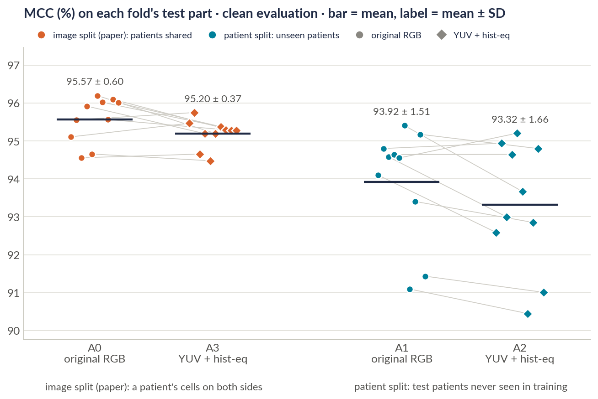

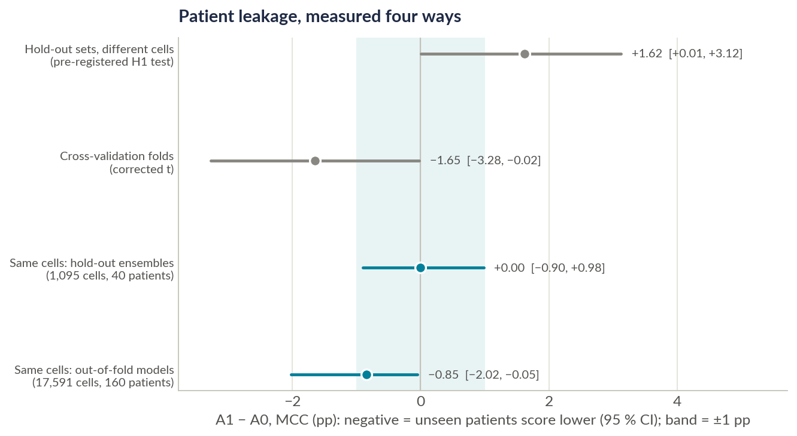

**Conclusion: the model generalises to new patients; patient leakage is small and now measured** (under about 2 pp of MCC, half a point of
accuracy). A0's models also trained on more patients, so these numbers, if anything, overstate it.

### H2: the model is already stain-robust

**The pre-registered rule.**

- A2 vs A1 mean fold MCC: **−0.60 pp**, within A1's fold SD of 1.51 pp, so by the pre-registered rule YUV brings **no gain**.
- The corrected t-test agrees (p = 0.13).

**The ensembles on the 40 unseen patients:**

| Metric | Change (95 % CI) |
|---|---|
| MCC | **−0.26 pp** (−0.85 to +0.23) |
| Recall | +0.18 pp (not significant) |
| Specificity | −0.44 pp (not significant after Holm) |
| ROC-AUC | −0.04 pp |

**Equivalence.**

- **Hold-out:** the 90 % CI is −0.73 to +0.16 pp, inside ±1 pp (TOST p = 0.008), so the effect is **practically
  zero**.
- **Fold level:** −1.27 to +0.06, which is too wide to show equivalence.

**The control, A3 vs A0.**

- Ensemble MCC +0.00 pp (95 % CI −0.52 to +0.53).
- Equivalent within ±1 pp at both levels.

The paper's augmented protocol gives the same three verdicts.

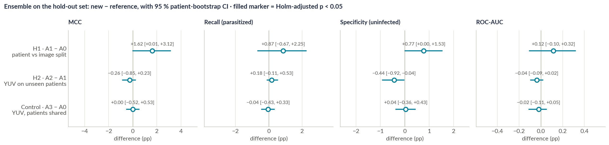

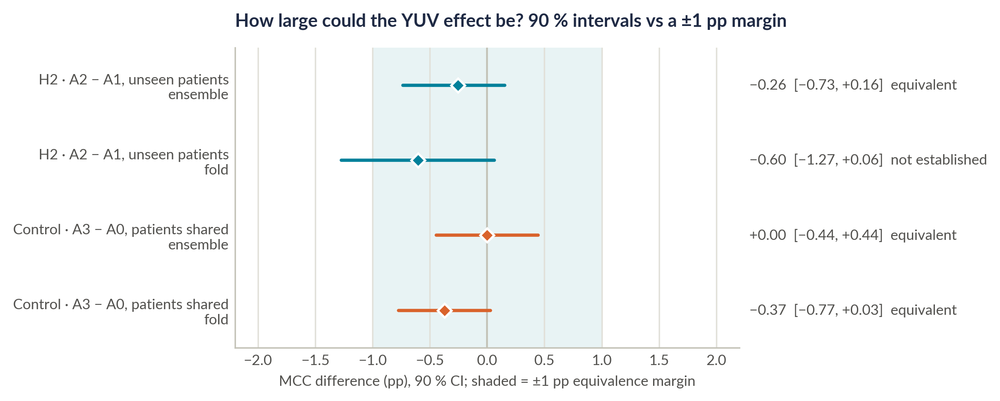

**How to state the two verdicts, the same way every time.**

- **H1: "accuracy holds on unseen patients."** The pre-registered rule needed a significant drop on unseen patients
  to support H1, and there was none. Leakage is measured, not assumed to be zero: the identical-cell test finds
  0.85 pp of MCC.
- **H2: "the model is already stain-robust."** The pre-registered rule asked for a gain larger than the fold spread.
  YUV's change is −0.60 pp against a 1.51 pp spread, and the equivalence test puts it within ±1 pp.

## What our predictions taught us

The brief says being wrong is fine and good reasoning is what counts. This section is the reasoning (slide 14).

| | We predicted | What happened | Most likely why (our experiments don't separate these) |
|---|---|---|---|
| **H1** | A clear drop on unseen patients and a wider spread | The spread widened 2.5× ✓. The drop is small: 0.85 pp MCC on identical cells, and none on the 40-patient hold-out | (1) The decisive cue, purple-stained parasite chromatin, looks alike in every patient. (2) The paper's heavy colour, contrast and blur augmentation already stops the network from relying on a patient's staining. (3) End-to-end fine-tuning learns the parasite better than the frozen features Rajaraman et al. used, who saw 98.6 → 95.9 % |
| **H2** | Higher recall and MCC on unseen patients | MCC −0.26 pp, within ±1 pp; recall +0.18 pp; specificity −0.44 pp | (1) YUV equalisation changes **brightness only**, not stain colour. (2) The augmentation already randomises brightness and contrast, including CLAHE, so nothing is left to fix. (3) Umer et al.'s 99.96 % vs 49.61 % compared against a model that didn't train, not a strong baseline. (4) All images come from one lab, so there is little stain variation to remove. (5) Stretching each cell's narrow brightness range amplifies texture and noise, which fits the slightly lower specificity |

**What we learned.**

- **Measure a gain against a strong baseline.** A preprocessing gain reported against a weak model may vanish against
  a strong one.
- **Use leakage-proof evaluation for small differences.** On a single random hold-out set, sub-1-pp differences
  between methods can't be resolved, because one draw of 40 patients moved accuracy by 1 pp. Cross-validate over
  patients, report patient-level intervals and pair the comparisons.
- **Test stain robustness the right way.** That means colour *augmentation* rather than normalisation (Tellez et al.
  2019), tested on another laboratory's smears (MP-IDB). This is our next experiment.

> **Say it like this.** "Our predictions taught us two things. For H1 we had the direction right, since the
> unseen-patient folds vary 2.5 times more, and the size is small because the parasite looks the same in everyone and
> the augmentation already hides each patient's stain: the model generalises. For H2 we tested a brightness fix, and
> the augmentation already covers brightness, so the baseline is already stain-robust."

## Step 6 · Failure analysis

### Where the errors are (slide 15)

The A1 ensemble classifies **5,464 of 5,550** unseen-patient cells correctly. Its **86 errors** are **55 missed parasites** (false negatives) and **31
false alarms** (false positives).

- **The errors cluster by patient.** Half of them come from 7 of the 40 patients, and 14 patients have none.
  - A permutation test rejects "errors spread evenly over patients" (p < 0.001).
  - The same holds out of fold: 619 errors over 160 patients.
- **False alarms fall on infected smears.**
  - 30 of the 31 are on infected patients' smears: 1.57 % of their uninfected-labelled cells, against 0.12 % in
    healthy patients (difference 1.45 pp, 95 % CI 0.82 to 2.14).
  - Out of fold, the rates are 2.35 % and 0.85 %.
  - Two explanations fit. Either the labeller missed some parasites, or these are genuinely ambiguous cells next to
    parasites (early rings, platelets, stain specks). Without an expert we can't tell which.
- **Candidate label errors** (confident learning, Northcutt et al. 2021):
  - 8 hold-out cells are flagged (7 labelled parasitized, 1 uninfected), and all 8 are among the errors.
  - Out of fold, 134 cells are flagged.
  - Removing the flagged cells leaves both YUV contrasts unchanged: A2 − A1 stays −0.25 pp, and A3 − A0 moves from
    0.00 to +0.04 pp.

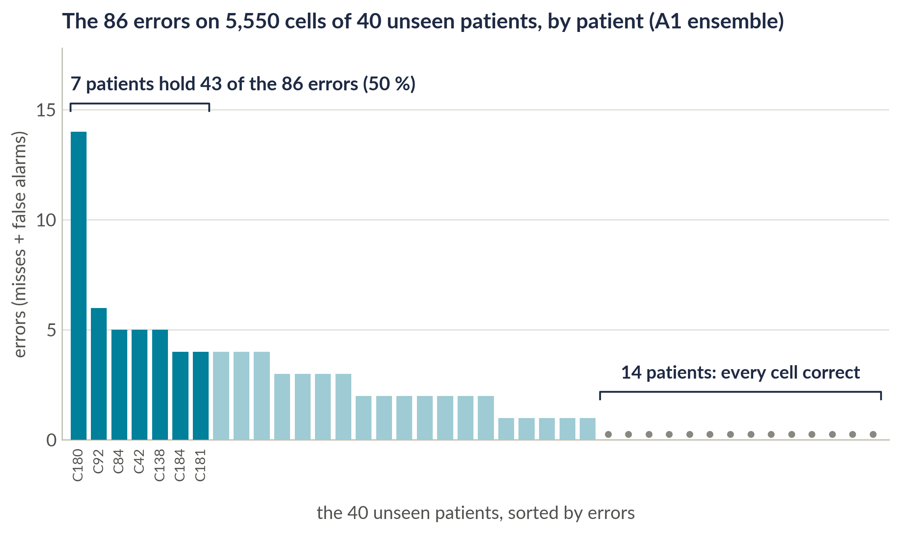

```python
def confident_learning_candidates(y, s):
    """A cell is a candidate label error when the other class's probability reaches that class's
    average confidence among the cells labelled with it (two-class confident learning)."""
    p_par, p_un = s, 1 - s
    t_par, t_un = p_par[y == 0].mean(), p_un[y == 1].mean()
    ...
```

### The blind triage: turning "possible label noise" into our own evidence

- **What the gallery is.** The 86 errors are shuffled with 86 correctly classified cells and numbered 1 to 172, with no
  labels shown. The pages are `results/phase3b/phase3b_triage_pages.pdf`.
- **What the raters do.** Two teammates each mark every cell: parasite visible (yes / no / unsure), plus one of eight
  categories.
- **The plan, fixed before anyone rated** (`docs/blind_triage_protocol.md`):
  - Cohen's κ between the two raters;
  - of the 31 false alarms, how many both raters call "yes";
  - of the 55 misses, how many both call "no";
  - the same counts on the correct cells as a baseline;
  - category counts.
- **The scorer.** `src/triage_score.py` implements this plan.
- **The labels are never changed.**
- **Status.** Pending until both sheets are in. If asked: "The protocol and the scoring code are committed. The
  results come after the two blind ratings."

### Screening view: recall first, no clinical claim (slide 16)

A missed infected cell is costlier than a false alarm, so we also report a recall-first operating point.

- **How it is chosen.** The threshold maximises **F2** (recall weighted 4× over precision) on the pooled out-of-fold
  **cross-validation** predictions. It is applied **once** to the hold-out set and never tuned on it.

| Experiment | Threshold | Recall: at 0.5 → at threshold | Specificity at threshold | ECE |
|---|---|---|---|---|
| A0 · image split | 0.192 | 97.18 → 98.72 % | 95.22 % | 0.053 |
| A1 · patient split | 0.189 | 98.05 → **99.22 %** | 93.93 % | 0.065 |
| A2 · patient split + YUV | 0.143 | 98.22 → 99.22 % | 91.74 % | 0.060 |
| A3 · image split + YUV | 0.159 | 97.14 → 98.75 % | 94.14 % | 0.052 |

- **Calibration.** ECE is 0.05 to 0.07: the probabilities are slightly *under*-confident, as label smoothing (targets of
  0.95) predicts.

### From cells to patients (slide 16, exploratory)

- **The rule.** A patient is called positive if **at least 3 cells have P(parasitized) ≥ 0.80**.
- **How it was chosen.** Only on the 160 cross-validation patients: the highest Youden J (sensitivity + specificity
  − 1) among rules with at least 95 % specificity.
  - On those patients: sensitivity 96.7 %, specificity 100 %.
  - With the rule selection nested inside the folds: 96.7 % and 97.4 %.
- **On the 40 unseen patients** (applied once):
  - **26 of 28** infected (92.9 %, exact 95 % CI 76.5 to 99.1);
  - **12 of 12** healthy (100 %, 73.5 to 100).
- **The two misses**, C53 and C73, are the only held-out patients with just three parasitized crops.
- **Why it is exploratory.**
  - NIH kept about 68 uninfected crops per patient but *curated* the parasitized ones.
  - With only one or two parasitized crops per patient, sensitivity falls to 3.6 % and 12.3 %.
  - So these numbers describe aggregation on curated crops, **not diagnostic accuracy on a real smear**.

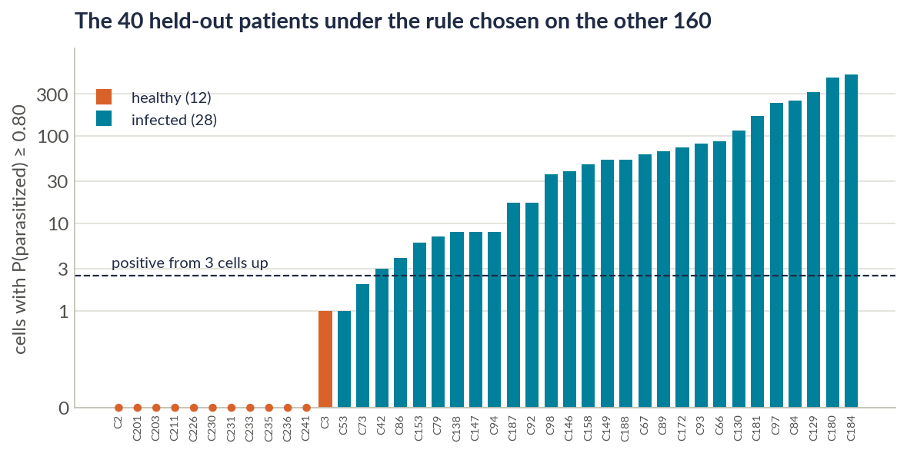

## Limitations, and how to talk about them

| Limitation | What it means |
|---|---|
| Curated cells, not smears | The patient-level rule is exploratory. NIH chose which crops to keep |
| One hospital | A patient split removes patient leakage, not site or staining-protocol effects. There is no external test set |
| One expert's labels | Fuhad et al. set aside 5.1 % of the cells as mislabelled or suspicious. Their list is no longer available, so we keep the original labels, as the paper did |
| One hold-out draw, one run per fold | A different draw of 40 patients or a second seed would move the numbers. The confidence intervals show by how much |
| Only 12 healthy held-out patients | The specificity interval is wide (73.5 to 100 %) |
| Same-cell comparison uses single models | Its interval omits run-to-run noise |
| Two GPU types (RTX 4090, L40S) | Within a fold, A1, A2 and A3 shared one GPU, so the paired comparisons use identical hardware |

**No clinical claims.**

- **Say:** "screening-oriented analysis", "exploratory", "on curated cells, not a smear", "accuracy holds on
  unseen patients", "equivalent within ±1 pp".
- **Never say:** "diagnoses malaria", "clinically ready", "proves", "no leakage".

## The paper and the code, section by section

### The IEEE paper (`Malaria_IEEE_Paper.pdf`, IEEEtran, 8 pages)

| Section | What it says | Numbers to know |
|---|---|---|
| Title, abstract | *98 % Accuracy Holds on Unseen Patients.* The whole result in 6 sentences | 97.62 vs 98.29 %; 98.45 %; 0.85 pp; ±1 pp |
| I · Introduction | The problem, two questions, five contributions | No new numbers |
| II · Related Work | 11 studies, two gaps | 96 to 99.9 % |
| III · Data | 27,558 cells, 200 patients, patient key | 10,364 uninfected cells from infected patients |
| IV-A · Reproduction | The code-exact recipe, 32 tests, the speed-ups | 4,223,934 parameters |
| IV-B · Ablation design | A0 to A3, patient split, YUV | 5,550 cells / 40 patients |
| IV-C · Statistics | Patient bootstrap, Nadeau-Bengio, Holm, decision rules, the exploratory addendum | 10,000 resamples |
| V-A to V-C · Results | Reproduction within 1 pp, 25 times faster; H1: accuracy holds on unseen patients, with leakage measured on identical cells; H2: the model is already stain-robust | Tables I to V |
| V-D · Screening operating point | Recall-first threshold, calibration | 98.7 to 99.2 % recall |
| V-E · Patient level | The rule chosen on CV patients | 26/28, 12/12 |
| V-F · Failure analysis | Errors by patient, false alarms, label-error candidates | 7 of 40 patients; 1.57 vs 0.12 % |
| V-G · Compute | 11 min per model; 30 models in about an hour | US$6.95 |
| VI · Discussion | Why the model generalises across patients, why to evaluate on several patient groups, why stain normalisation is redundant | 2.3× / 2.6× design effect |
| VII · Limitations | As in section 9 above | No new numbers |
| VIII · Conclusion | Four takeaways and four next steps | 98.45 %; under 2 pp; ±1 pp; 26/28 and 12/12 |

### The code (`github.com/amathziah/malaria-detection`)

| File | What it does |
|---|---|
| `src/marques2022_exact.py` | The paper-exact recipe: data, splits (image and patient), YUV, model, training, the ensemble (32 tests) |
| `src/runpod_10fold.py` | Launches one cloud GPU per fold and collects the results |
| `src/make_ablation_splits.py` | Builds and checks the patient split against NIH's patient mapping; YUV example figure |
| `src/ablation_stats.py` | Metrics, patient bootstraps, corrected t-tests, Holm, threshold, calibration, verdicts |
| `src/ablation_figures.py` | The Phase 3 figures |
| `src/phase3b_analysis.py` | Equivalence, same-cell leakage, the patient-level rule, the error audit, the blinded gallery |
| `src/triage_kit.py`, `src/triage_score.py` | Triage pages (numbers only) and the pre-planned triage scoring |
| `docs/ieee/make_tables.py` | Writes every table of the paper from `results/`, so no number is typed by hand |
| `notebooks/Phase3_Ablation_A1_A3.ipynb` | Trains A1 to A3, one pod per fold |
| `tests/` | Over 130 automated tests |

**Trained models.** All 40 are public, so nothing has to be retrained:

- release `v1.0-a0-10fold`: the 10 A0 models;
- release `v2.0-ablation`: the 30 A1 to A3 models, with SHA-256 checksums.

## Numbers card

| Number | Meaning |
|---|---|
| **27,558 / 200** | cells / patients (150 infected, 50 healthy); half of the cells parasitized |
| **75 %** | of uninfected cells come from infected patients' smears |
| **4,223,934** | parameters, exactly the paper's Table 2 |
| **97.55 vs 97.56 %** | our mean fold accuracy vs the paper's |
| **97.62 vs 98.29 %** | our ensemble accuracy vs the paper's (every metric within 1 pp) |
| **99.73 vs 99.76 %** | ensemble ROC-AUC, ours vs the paper's |
| **≈ 11 min vs 4 h 46 min** | training time per fold, RTX 4090 vs the paper's GTX 1050 |
| **5,550 / 40** | cells / patients in our patient-level hold-out set (28 infected) |
| **98.45 %** | A1 accuracy on 40 unseen patients (95 % CI 97.94 to 98.91); recall 98.05 %, AUC 99.80 % |
| **+1.62 pp** | H1's pre-registered test (ensemble MCC; Holm p = 0.15): no drop on unseen patients |
| **−1.65 pp** | H1 in cross-validation (fold MCC; Holm p = 0.14): small, not significant after correction; spread 2.5× wider, as predicted |
| **−0.85 pp** | leakage on 17,591 identical cells (MCC; 95 % CI −2.02 to −0.05) |
| **−0.26 pp** | H2, YUV on unseen patients (ensemble MCC; 90 % CI −0.73 to +0.16, within ±1 pp): already stain-robust |
| **−0.60 vs 1.51 pp** | H2's fold change vs A1's fold SD: the pre-registered decision rule |
| **86 = 55 + 31** | A1's errors: missed parasites + false alarms |
| **7 of 40** | patients carrying half of the errors |
| **1.57 vs 0.12 %** | false-alarm rate on infected vs healthy patients' smears |
| **99.22 %** | A1 recall at the threshold chosen on CV (93.93 % specificity) |
| **26/28 · 12/12** | infected / healthy unseen patients found by the per-patient rule (exploratory) |
| **0c086ee** | the commit that fixed the analysis plan before training |
| **1 to 3 · 4 to 6 · 7 to 9 · 10 · 11 to 14 · 15 to 17** | deck slides: opening, then Parts 1 to 5 (references on slide 18) |

## Question drill: 32 likely questions

**About the reproduction**

1. **Why this paper?** It's a strong result (98.29 %, AUC 99.76 %), and its authors published their executed
   notebook. That made a code-exact reproduction possible, which almost no other paper allows.
2. **How do you know your rebuild matches?** 32 automated tests compare it with the paper's printed outputs: the
   parameter count, split sizes, augmentation, image loading, loss and callbacks, and classification reports. The
   fold models match to 0.01 pp.
3. **Why is your ensemble 0.67 pp lower?** The paper's split was unseeded and can't be recreated, and we use a newer
   TensorFlow. Our ensemble gains less over its members (0.25 vs 0.60 pp). Every metric is within our 1 pp criterion.
4. **What did you find in the paper's reporting?** Its text swaps precision and recall. Its code scored augmented test images. Its
   Table 6 "accuracy" is (P + R) / 2. And the text differs from the code in 8 settings.
5. **Did you do feature engineering?** No hand-made features: the CNN learns them. We only resize and use the paper's
   augmentation. YUV normalisation is the one preprocessing change, and it was our hypothesis.
6. **Why EfficientNet-B0?** It was the paper's model, gives the best accuracy per parameter of its generation, and at
   4.2 M parameters is small enough for a phone later.
7. **Why ten folds and an ensemble?** Every learning cell is tested once, we get a mean and a spread, and averaging
   ten models cancels some individual mistakes.
8. **How did you train 25× faster without changing the results?** We decode once, run the augmentation in parallel
   with seeds, send uint8 batches to the GPU, compile the step with XLA, and train 10 folds on 10 GPUs. The maths is
   the same float32.

**About the hypotheses**

9. **The brief said one change; you made two?** Each experiment changes one thing. Our method change is YUV
   normalisation (H2). The patient split (H1) changes how we test, not the model; we needed it so H2 is measured on
   unseen patients. A3 controls for it.
10. **What does "pre-registered" mean, and how can we check?** The hypotheses, primary metric, tests and decision
    rules were committed to GitHub (commit `0c086ee`, 2 Nov 03:24) before any A1 to A3 model was trained. The later
    analyses were committed in a dated addendum before they were run. The commit times prove the order.
11. **How do the two verdicts differ?** H1's rule needed a significant drop on unseen patients to support it, and
    there was none, so the accuracy holds. H2's rule asked for a gain larger than the fold spread; YUV's change was
    −0.60 pp against 1.51 pp, and the equivalence test puts it within ±1 pp, so the model is already stain-robust.
12. **If leakage exists, why is accuracy on unseen patients higher (98.45 vs 97.64 %)?** Those are different test
    sets, and the 40-patient draw is easy: the same models score 98.22 % on it but 97.24 % in cross-validation. On
    *identical* cells, unseen-patient models are slightly worse.
13. **So is there leakage or not?** Yes, but small: 0.85 pp of MCC (about half a point of accuracy) on 17,591
    identical cells across 160 patients, and none detectable on the 1,095 cells of the 40 held-out patients.
14. **Why is YUV unnecessary here?** It equalises brightness only, not stain colour. The augmentation already varies brightness
    and contrast, all images come from one lab, and the equivalence test puts the effect within ±1 pp.
15. **What result would have confirmed your predictions?** For H1, a significantly lower ensemble MCC on unseen
    patients. For H2, a fold gain larger than the fold spread. The data showed the stronger result: the accuracy
    holds, and the baseline is already stain-robust.

**About the statistics**

16. **Why MCC rather than accuracy?** It uses all four confusion-matrix cells and is high only when both classes are
    right. We fixed it as the primary metric before training. We still report accuracy, recall, specificity and AUC.
17. **Why resample patients rather than cells?** A patient's cells are correlated. Resampling whole patients gives
    honest intervals: the variance is 2.3× (accuracy) to 2.6× (MCC) what a per-cell bootstrap would claim.
18. **Why did a p-value change from 0.023 to 0.14?** The plan's Welch test treated the ten folds as independent, but
    any two folds share 8 of 9 training parts. The Nadeau-Bengio correction accounts for that. We report both values
    and describe the result as a small trend, not significant after correction.
19. **What is the Holm correction for?** We test three contrasts, so the chance of one false "significant" rises.
    Holm adjusts the p-values for that.
20. **Isn't "not significant" enough to say YUV does nothing?** No: a weak test is also "not significant". The
    equivalence test shows the 90 % CI (−0.73 to +0.16 pp) lies inside ±1 pp, so the effect is practically zero, and
    the paired design could detect 0.77 pp.
21. **Did you tune anything on the test set?** No. The threshold and the patient rule were chosen on the
    cross-validation predictions only and applied once to the hold-out set.

**About the failure analysis**

22. **What kinds of errors does the model make?** 55 missed parasites and 31 false alarms out of 5,550. They cluster
    in a few patients: half come from 7 of the 40.
23. **Why are almost all false alarms on infected patients' smears?** 30 of 31 are. Either the labeller missed some
    parasites, or the cells are genuinely ambiguous. We can't tell without an expert, which is why we set up a blind
    triage.
24. **What is confident learning, and what did it find?** It flags cells whose label disagrees with a confident
    model. It found 8 hold-out candidates, all among the errors. Removing them changes no verdict.
25. **What is the blind triage?** Two of us rate 172 cells (86 errors and 86 correct) without knowing which is which,
    using a scoring plan fixed in advance. The labels are never changed.

**About screening, patients and the clinic**

26. **Why recall first, and how did you pick the threshold?** A missed infection costs more than a false alarm. We
    chose the threshold with the best F2 on the cross-validation predictions, then applied it once: recall rose to
    99.22 % at 93.93 % specificity.
27. **Could this diagnose malaria in a clinic?** Not yet, and we don't claim it. The patient-level result is
    exploratory, on curated crops from one hospital, with no external test set.
28. **What do 26/28 and 12/12 mean?** A rule chosen only on the 160 CV patients, "positive if at least 3 cells have
    P ≥ 0.80", found 26 of 28 infected and all 12 healthy unseen patients. The two misses had only 3 parasitized
    crops each.

**About limits and next steps**

29. **What are your main limitations?** Curated cells, one hospital, one labeller, one hold-out draw and one run per
    fold, and only 12 healthy held-out patients.
30. **What would you do with more time?**
    - Test on another lab's smears (MP-IDB), with a stain-colour augmentation arm.
    - Finish the triage and compare it with an independent relabelling of the dataset.
    - Evaluate patient rules on whole smears.
    - Distil the ensemble into one phone-sized model.

**The tough ones**

31. **Isn't your main finding just that the paper was right?** That is a strong finding: the headline holds under a
    stricter, pre-registered, patient-level test. We also measured the leakage precisely, found and corrected three
    reporting errors, and showed that a preprocessing gain reported in the literature is unnecessary for a strong
    baseline.
32. **Why trust a 40-patient hold-out set?** We don't trust it alone. We also cross-validate over 160 patients, pair
    comparisons on identical cells, and give patient-bootstrap intervals that show the uncertainty.

## Glossary of the Phase 3 terms

| Term | Plain meaning |
|---|---|
| Ablation | An experiment that changes one thing to see what it does |
| Addendum | A dated, committed note fixing extra analyses before running them |
| Clean / augmented protocol | Scoring the original test images / randomly altered ones, as the paper's code did |
| Clopper-Pearson interval | An exact confidence interval for a proportion such as 26/28 |
| Cluster (patient) bootstrap | Resampling whole patients, not cells, to get honest intervals |
| Cohen's κ | Agreement between two raters beyond chance: 0 = chance, 1 = perfect |
| Confident learning | Flagging cells whose label disagrees with a confident model |
| Design effect | How much clustering inflates the variance compared with independent cells (2.3× to 2.6× here) |
| ECE (expected calibration error) | The average gap between predicted probability and observed frequency |
| Equivalence test (TOST) | Shows an effect is inside a negligible margin (±1 pp), not just "not significant" |
| F2 | The F-score with recall weighted 4× more than precision |
| Fingerprint | A short hash of a split, checked by every run so all runs use the same split |
| Holm correction | Adjusts p-values when testing several contrasts |
| MCC | Matthews correlation coefficient: −1 to 1 (we show × 100), using all four confusion-matrix cells |
| MDE (minimum detectable effect) | The smallest true effect a design detects 80 % of the time |
| Nadeau-Bengio correction | Widens the t-test for cross-validation folds that share training data |
| Out-of-fold (OOF) prediction | A cell's prediction from the fold model that did not train on it |
| Paired / unpaired comparison | The same cells in both arms / different cells |
| Patient leakage | Cells of one patient in both training and test, so a test can reward recognising the patient |
| Patient split | Whole patients go to training or to test, never both |
| pp (percentage points) | The plain difference between two percentages (98.45 − 97.64 = 0.81 pp) |
| Pre-registration | Fixing hypotheses, metric, tests and decision rules before the experiment, with a timestamp |
| Soft voting | Averaging the ten models' probabilities |
| StratifiedGroupKFold | Folds that keep each group (patient) together and balance the classes |
| YUV / luma histogram equalisation | A colour space with brightness (Y) apart from colour (U, V) / stretching Y's histogram over the full range |
| Youden J | Sensitivity + specificity − 1; used to choose the patient rule |
