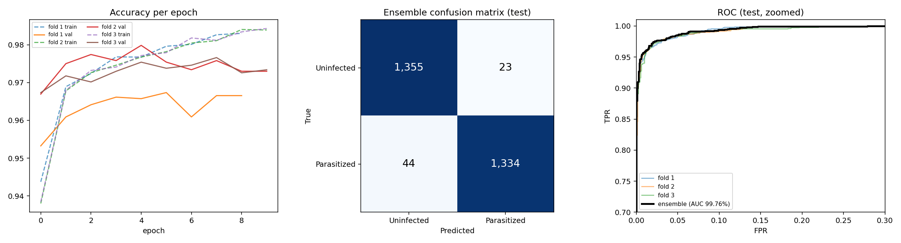
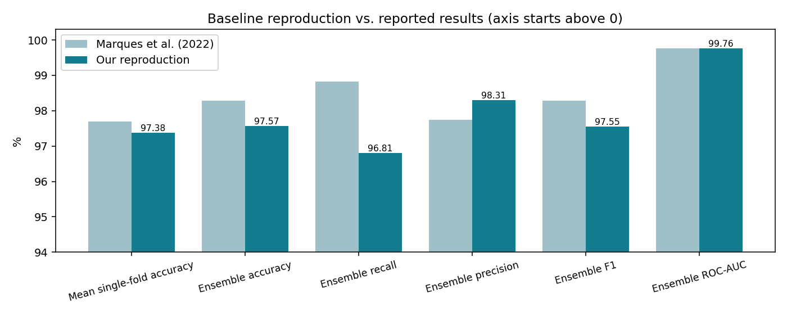
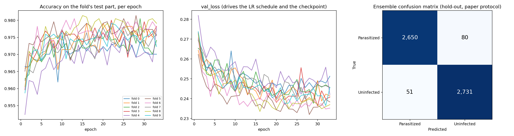
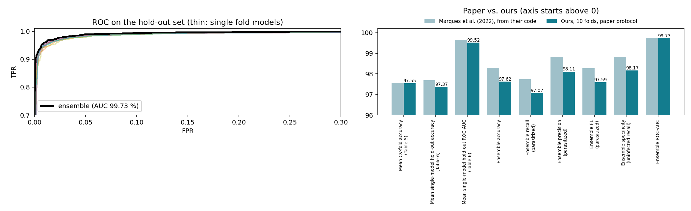
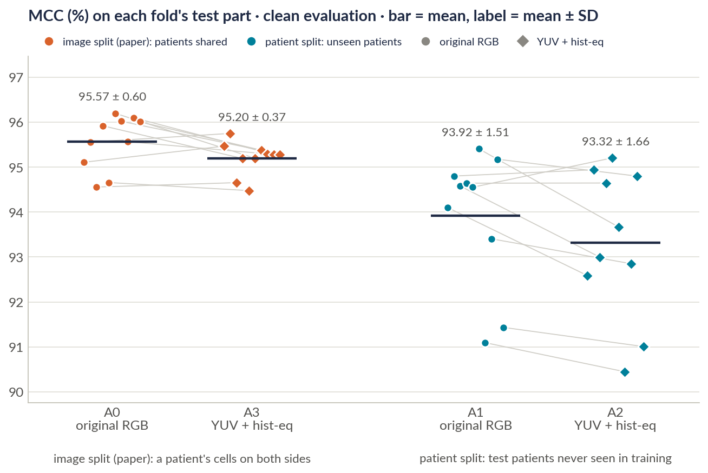
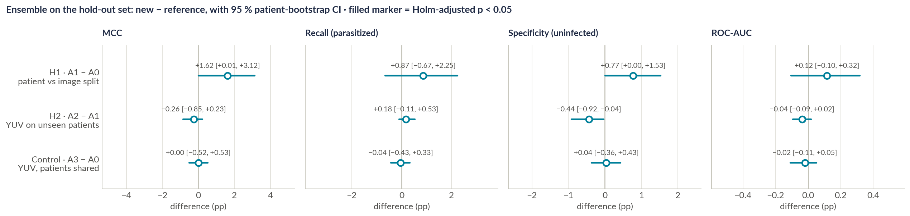
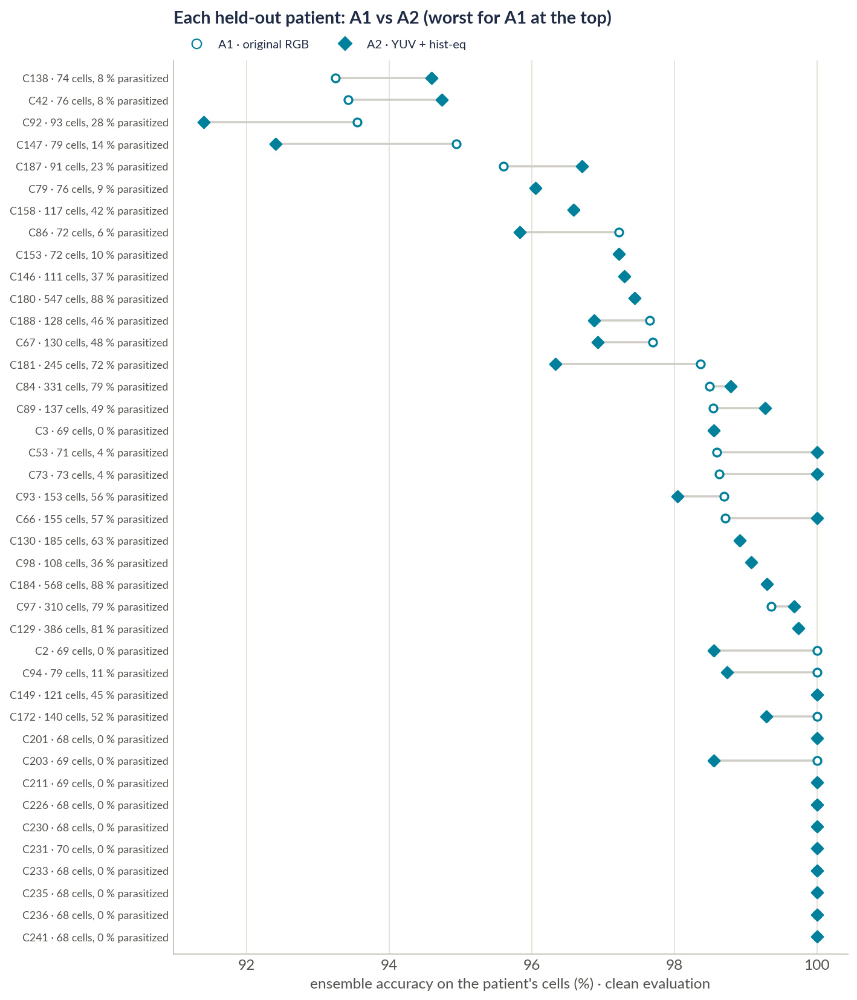
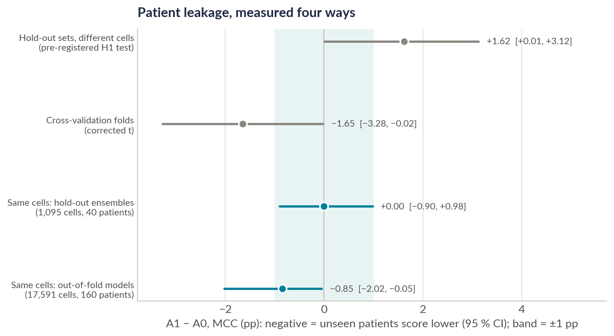

# Project Report: Automated Malaria Cell Detection

## 1. Introduction

Malaria is diagnosed by looking at Giemsa-stained blood smears under a microscope, where a trained technician checks each red blood cell for parasites. This works, but it is slow (each slide holds hundreds of cells), it depends on scarce expert skill (especially in the rural regions where malaria is common), and results vary between observers and labs.

Our goal is an automated deep-learning system that classifies single red-blood-cell images as **parasitized** or **uninfected**, accurately and consistently, and light enough to eventually run at the point of care.

Phase 1 surveyed 11 published studies. In Phase 2 we reproduced the strongest-documented one, Marques et al. (2022), as our baseline. In Phase 3 we tested whether its accuracy holds once patient-level leakage is removed (H1) and whether YUV stain normalisation helps on unseen patients (H2). The IEEE-format paper is in [`docs/ieee/`](ieee/).

## 2. Baseline reproduction (Marques et al., 2022)

**Goal.** Rebuild the paper's model on the same data and check we land within about 1 percentage point of its reported results. This becomes our Phase 2 baseline (experiment A0).

**Method.**
- Data: NIH malaria cell images, 27,558 cells (13,779 parasitized, 13,779 uninfected), Kaggle mirror.
- Model: EfficientNet-B0 pretrained on ImageNet, 224 × 224 input, dropout 0.2.
- Training: Adam (lr 1e-4), ReduceLROnPlateau (patience 6, down to 1e-6), up to 15 epochs with early stopping (patience 5).
- Validation: 10 % untouched hold-out test set; the rest split by stratified 10-fold CV. We trained 3 of the 10 folds (free GPU budget) and averaged them into an ensemble.
- Hardware: Kaggle, 2× Tesla T4 (global batch 128).

**Results** (`results/A0_baseline/`):

| Metric | Paper | Ours | Δ (pp) |
|---|---|---|---|
| Mean single-fold accuracy | 97.70 % | 97.38 ± 0.74 % | −0.32 |
| Ensemble accuracy | 98.29 % | 97.57 % | −0.72 |
| Recall | 98.82 % | 96.81 % | −2.01 |
| Precision | 97.74 % | 98.31 % | +0.57 |
| F1 | 98.28 % | 97.55 % | −0.73 |
| ROC-AUC | 99.76 % | 99.76 % | 0.00 |
| MCC | not reported | 0.95 | n/a |

*The paper column is the paper's text. Its recall and precision are swapped there: the authors' code gives recall 97.74 % and precision 98.82 % (see Section 3).*

**Deviations from the paper.** We kept every setting the paper reports. Where it is silent or our compute was limited, we chose:

| Setting | Paper | Ours | Why |
|---|---|---|---|
| Augmentation | Albumentations (details not listed) | Flips + 90° rotations | Paper doesn't specify its pipeline |
| Epochs | Not reported | ≤ 15, early stopping (patience 5) | Fits a free GPU session |
| Folds trained | 10 | 3 of 10 | Free GPU budget (~21 min per fold) |
| Batch size | Not reported | 64 per GPU, 128 global (2× T4) | Kaggle provided two GPUs |
| Test set | Not described | 10 % hold-out, never used in training | Clean ensemble evaluation |

**Takeaway.** Both headline accuracies are within 1 pp of the paper, so the reproduction succeeds and A0 is our baseline. On the test set the model missed 44 infected cells and wrongly flagged 23 healthy ones.

**Correction (found in Section 3).** The paper's text swaps the ensemble's precision and recall. Its own code output gives recall 97.74 % and precision 98.82 %, so A0's recall gap is 0.93 pp (96.81 vs. 97.74 %), not 2 pp, and its precision is 0.51 pp lower rather than higher.

## 3. Paper-exact 10-fold reproduction

**Why a second reproduction.** The paper's supplementary material (Springer file MOESM1) is the authors' executed Jupyter notebook. It specifies everything the text leaves out, and in several places it differs from what the text and our first reproduction assumed. We rebuilt the experiment from that code and trained all 10 folds.

**What the paper's code does differently** (first reproduction in brackets):

| Setting | Paper's code | (A0, from the text) |
|---|---|---|
| Pretrained weights | noisy-student, `efficientnet` 1.1.1 (qubvel) | (ImageNet, `tf.keras.applications`) |
| Classifier head | GAP → Dense 128 → Dense 64 → Dense 32 (ReLU, dropout 0.3 each) → Dense 2 softmax | (GAP → dropout 0.2 → Dense 1 sigmoid) |
| Loss | categorical cross-entropy, label smoothing 0.1 | (binary cross-entropy) |
| Schedule | 33 epochs, ReduceLROnPlateau factor 0.5, best-val_loss checkpoint, no early stopping | (≤ 15 epochs, factor 0.1, early stopping) |
| Batch size | 16 (1,240 steps per epoch) | (128) |
| Hold-out set | 20 % = 5,512 images; folds: StratifiedKFold(10, shuffle, random_state=50) | (10 % = 2,756 images) |
| Augmentation | albumentations `Compose` with rotations, flips, noise, blur, affine and elastic-type distortions, CLAHE, sharpen, emboss, contrast, brightness | (flips + 90° rotations) |
| Input | cv2 nearest-neighbour resize, pixels / 255 | (bilinear resize, ImageNet normalisation) |
| Evaluation images | augmented (one generator for training, test and hold-out) | (clean) |

**Method.** `src/marques2022_exact.py` implements that recipe with the same library generation (TensorFlow 2.15 with Keras 2, `efficientnet` 1.1.1, `albumentations` 0.5.2, `imgaug` 0.4.0). 32 tests (`tests/test_marques2022_exact.py`) compare it with the paper: the parameter counts of its Table 2 (4,223,934 total, 4,181,918 trainable), the split and fold sizes printed by its code, its exact augmentation pipeline, image loading identical to `ImageDataAugmentor`, the loss, optimiser and callbacks, and its classification reports. The file list is sorted and the hold-out split seeded (the paper's was not) so that every machine builds the same split; a split fingerprint stored with each fold confirms it.

**Compute.** Each fold ran on its own RunPod RTX 4090 (10 pods in parallel), launched and collected by `src/runpod_10fold.py`. Training took 10.5 to 11.1 min per fold (16.6 min on one slower host), against 4 h 46 min per fold in the paper (GTX 1050; mean of its printed fold times). The speed-ups do not change the computation: images are decoded once into a uint8 cache; the paper's augmentation runs in 11 worker processes, each batch seeded by (fold, epoch, batch) and each worker limited to one BLAS thread (3× faster than the default); batches are sent to the GPU as uint8 and divided by 255 in the model; the training step is XLA-compiled (21 → 12.5 ms per step). Arithmetic stays in float32, as in the paper.

**Results** (`results/A0_10fold_paper/`). "Paper protocol" scores augmented images, as the paper's code did; "clean" scores the original images.

| Metric | Paper (code output) | Ours, paper protocol | Ours, clean | Δ (pp) |
|---|---|---|---|---|
| Mean fold accuracy on the CV test part (Table 5) | 97.56 % | 97.55 ± 0.30 % | 97.78 % | −0.01 |
| Mean single-model accuracy on the hold-out set (Table 6) | 97.69 % | 97.37 % | 97.48 % | −0.32 |
| Mean single-model ROC-AUC on the hold-out set (Table 6) | 99.65 % | 99.52 % | 99.52 % | −0.13 |
| **Ensemble accuracy** | **98.29 %** | **97.62 %** | 97.64 % | −0.67 |
| Ensemble recall (parasitized) | 97.74 % | 97.07 % | 97.18 % | −0.67 |
| Ensemble precision (parasitized) | 98.82 % | 98.11 % | 98.04 % | −0.71 |
| Ensemble F1 (parasitized) | 98.28 % | 97.59 % | 97.61 % | −0.69 |
| Ensemble specificity | 98.84 % | 98.17 % | 98.09 % | −0.67 |
| Ensemble ROC-AUC | 99.76 % | 99.73 % | 99.68 % | −0.03 |

On the hold-out set the ensemble missed 80 of 2,730 infected cells and flagged 51 of 2,782 healthy ones (paper: 62 of 2,744 and 32 of 2,768).

**Findings about the paper.**
1. *Precision and recall are swapped in the text.* The text reports recall 98.82 % and precision 97.74 %; the printed report of its ensemble gives parasitized precision 0.988209 and recall 0.977405.
2. *Evaluation on augmented images.* The paper's test and hold-out generators come from the same augmenting `ImageDataAugmentor` object, so every reported prediction was made on a randomly transformed image. Scoring clean images changes our numbers by at most 0.23 pp, so this does not explain the results.
3. *Table 6's "accuracy" column* is (precision + recall) / 2 of each printed report, which gives an average of 97.70 % instead of the true 97.69 %.

**Deviations that remain.** TensorFlow 2.15 instead of 2.3 and RTX 4090 GPUs instead of a GTX 1050 (modern GPUs need a newer TensorFlow; the Keras 2 API and the Adam implementation are the same); a seeded, sorted split instead of the paper's unseeded one, which cannot be recovered; augmentation seeded per batch instead of one global random stream; exactly 1,240 full batches per epoch, the count the paper states.

**Takeaway.** The fold models match the paper almost exactly (97.55 vs. 97.56 % on the CV test parts), and every headline metric is within 1 pp. The ensemble is 0.67 pp short of the paper's 98.29 %: our ensemble gains 0.25 pp over its average member where the paper's gained 0.60 pp. The gap is about three standard errors of a 5,512-image test set, so part of it is likely real; the paper's unrecoverable split and the different software and hardware are the remaining candidates. This 10-fold run replaces A0 as the reference for the hypothesis experiments.

## 4. Hypothesis results (Phase 3)

**Plan, fixed before the runs** ([`docs/phase3_analysis_plan.md`](phase3_analysis_plan.md)):
- Each experiment changes one thing against A0's paper-exact recipe:
  - A1: patient split.
  - A2: patient split + YUV histogram equalisation.
  - A3: the paper's split + YUV, as a control.
- **Patient split.** Patients are the file names' C-numbers, checked against NIH's own patient mapping (200 patients). The hold-out set is 40 patients (5,550 cells, 50.7 % parasitized); the other 160 patients are split into 10 folds.
- **Pairing.** A1 and A2 share their split. A3 reuses A0's split exactly, so both pairs compare the same cells.
- **Analysis.**
  - Primary protocol: clean evaluation. Primary metric: MCC.
  - Every interval comes from a bootstrap over patients.
  - Paired contrasts use the Nadeau-Bengio corrected t-test over folds.
  - Holm correction over the three contrasts.

**Compute.** 30 models (10 folds × 3 experiments) on 10 RunPod pods (7× RTX 4090, 3× L40S; each pod trained one fold of A1, A2 and A3 in turn). The run took about one hour of wall-clock time and cost $6.95.

**Results** (`results/ablation/`, clean evaluation, %; MCC × 100; ensemble values with 95 % patient-bootstrap CIs):

| ID | Split | Preprocessing | Hold-out cells / patients | Fold MCC (mean ± SD) | Fold accuracy (mean ± SD) | Ensemble accuracy | Ensemble MCC | Ensemble recall |
|---|---|---|---|---|---|---|---|---|
| A0 | image | none | 5,512 / 200 | 95.57 ± 0.60 | 97.78 ± 0.30 | 97.64 [97.02, 98.17] | 95.29 [94.03, 96.32] | 97.18 [96.03, 98.06] |
| A1 | patient | none | 5,550 / 40 | 93.92 ± 1.51 | 97.24 ± 0.66 | **98.45** [97.94, 98.91] | 96.90 [95.70, 97.79] | 98.05 [96.79, 98.85] |
| A2 | patient | YUV | 5,550 / 40 | 93.32 ± 1.66 | 96.96 ± 0.75 | 98.32 [97.71, 98.86] | 96.65 [95.23, 97.68] | 98.22 [97.02, 99.02] |
| A3 | image | YUV | 5,512 / 200 | 95.20 ± 0.37 | 97.60 ± 0.19 | 97.64 [97.02, 98.17] | 95.29 [94.04, 96.32] | 97.14 [95.94, 98.05] |

**H1 (patient leakage): not supported by the pre-registered test. Leakage is real but small.**
- On the 40 unseen patients the A1 ensemble scores **98.45 %** (MCC 96.90). That is no lower than A0's 97.64 %: the difference in MCC is +1.62 pp, 95 % CI +0.01 to +3.12, Holm p = 0.146. **The paper's ~98 % survives unseen patients.**
- Cross-validation over the other 160 patients is a broader test than one hold-out draw, and it points the way H1 predicted, at a small size:
  - mean fold MCC 93.92 vs 95.57: a point estimate of −1.65 pp (95 % CI −3.28 to −0.02, Holm p = 0.14). Our plan's uncorrected Welch test gave p = 0.0075 (Holm 0.023); it treated each arm's folds as independent, although they share their training data, and overstated the evidence (correction in `docs/phase3b_addendum.md`);
  - fold accuracy 97.24 vs 97.78 %;
  - 2.5× the fold-to-fold spread (MCC SD 1.51 vs 0.60).
- The same A1 models score 98.22 % on the 40 held-out patients but 97.24 % in cross-validation, so this hold-out draw is about 1 pp easier than an average group of unseen patients. Comparing two different hold-out sets could also only detect about 2.2 pp of MCC.
- **On identical cells (Phase 3b)** both problems disappear:
  - Across the 17,591 cross-validation cells both arms share, A1's out-of-fold models score 0.85 pp lower in MCC than A0's (95 % CI 0.05 to 2.02; accuracy −0.43 pp).
  - On the 1,095 A0 hold-out cells of A1's 40 held-out patients, the two ensembles have identical confusion matrices (difference 0.00 pp, 95 % CI −0.90 to +0.98).
  - Patient leakage is therefore real, but small.
- With unseen-patient validation the best epoch also comes earlier (median 17 vs 28.5).

**H2 (YUV stain normalisation): rejected.**
- On the same unseen patients, A2 vs A1 changes mean fold MCC by −0.60 pp. That is below A1's fold SD of 1.51 pp, so the pre-registered rule rejects H2; the corrected t-test gives p = 0.13.
- The ensemble MCC changes by −0.26 pp (95 % CI −0.85 to +0.23). An equivalence test (Phase 3b) bounds it: the 90 % CI −0.73 to +0.16 lies inside ±1 pp, so the effect is practically zero. At the fold level the interval (−1.27 to +0.06) is too wide to show that.
- Specificity drops slightly (−0.44 pp; not significant after Holm correction).
- The step equalises brightness (luma) only, not stain colour, and the training pipeline already randomises brightness and contrast.

**Control (A3 vs A0).** YUV under the paper's split shows no detectable change (MCC +0.00 pp, 95 % CI −0.52 to +0.53; equivalent within ±1 pp).

All three verdicts are the same under the paper's augmented protocol (`results/ablation/paper_protocol/`).

**For screening:**
- A decision threshold chosen on the CV folds (max F2) raises hold-out recall to 98.7 to 99.2 %, at 91.7 to 95.2 % specificity.
- The ensembles are slightly under-confident (ECE 0.05 to 0.07), as the paper's label smoothing predicts.

**Phase 3b: exploratory analyses on the saved predictions** (`results/phase3b/`; fixed in `docs/phase3b_addendum.md` before running):
- *Patient-level diagnosis.* The rule is chosen on the 160 CV patients: a patient is positive if at least 3 cells have P(parasitized) ≥ 0.80.
  - On the 40 held-out patients it identifies 26 of 28 infected (92.9 %, exact 95 % CI 76.5 to 99.1) and all 12 healthy patients (100 %, 73.5 to 100).
  - The two missed patients (C53, C73) are the only ones with just 3 parasitized crops. With only 1 to 2 parasitized crops per patient, sensitivity falls to 3.6 to 12.3 %.
  - NIH curated the crops (about 68 uninfected per patient), so this is aggregation on curated crops, not diagnostic accuracy on a smear.
- *Errors cluster by patient* (permutation test p < 0.001).
  - False alarms concentrate in infected patients' smears: 1.57 % of their uninfected-labelled cells against 0.12 % in healthy patients (out of fold: 2.35 vs 0.85 %).
  - This fits parasites missed in the labels or genuinely ambiguous cells; we cannot tell which without an expert.
- *Candidate label errors.* Confident learning flags 8 hold-out cells; removing them changes no verdict.
- *Blind triage.* A gallery of all 86 errors mixed with 86 correct cells (`phase3b_error_gallery.png`) is ready for the team's triage.
- *Clustering inflates uncertainty.* Patient clustering inflates the variance of hold-out accuracy 2.3-fold, so the paired comparisons can detect about 0.8 pp of MCC and the unpaired H1 comparison about 2.2 pp.

**Limitations.**
- The task is single-cell classification. The patient-level analysis is exploratory, on curated crops with 12 healthy held-out patients.
- All data comes from one hospital, with no external test set.
- Labels come from one expert. Fuhad et al. set aside 1,397 cells (5.1 %) as mislabelled or suspicious, but their list is no longer online.
- There is one 40-patient hold-out draw and one training run per fold and arm.
- A1 to A3 ran on 7 RTX 4090s and 3 L40S, whereas A0 ran on RTX 4090s only. Within a fold, A1, A2 and A3 shared one GPU.

## 5. Conclusion and next steps

- The paper's recipe reproduces within 1 pp from its own code.
- Its accuracy largely survives unseen patients: 98.45 % on 40 held-out patients. Leakage is real but small: about half a point of accuracy (0.43 pp on identical cells, 0.54 pp in cross-validation).
- YUV histogram equalisation, a preprocessing step reported as very effective in the literature, does not help a strong augmented baseline: its effect on unseen patients lies within ±1 pp of MCC.
- Combined per patient, the cell calls identify 26 of 28 infected and all 12 healthy held-out patients (exploratory, curated crops).

Next steps:
- Test on an external dataset from another laboratory (MP-IDB *P. falciparum* is the closest public match), ideally with a stain-colour augmentation arm.
- Triage the blinded error gallery, and re-read the errors against Michael Delves's independent relabelling of the dataset (IEEE DataPort).
- Evaluate patient-level rules on whole smears rather than curated crops.
- Distil the ensemble into one light model for point-of-care use.
